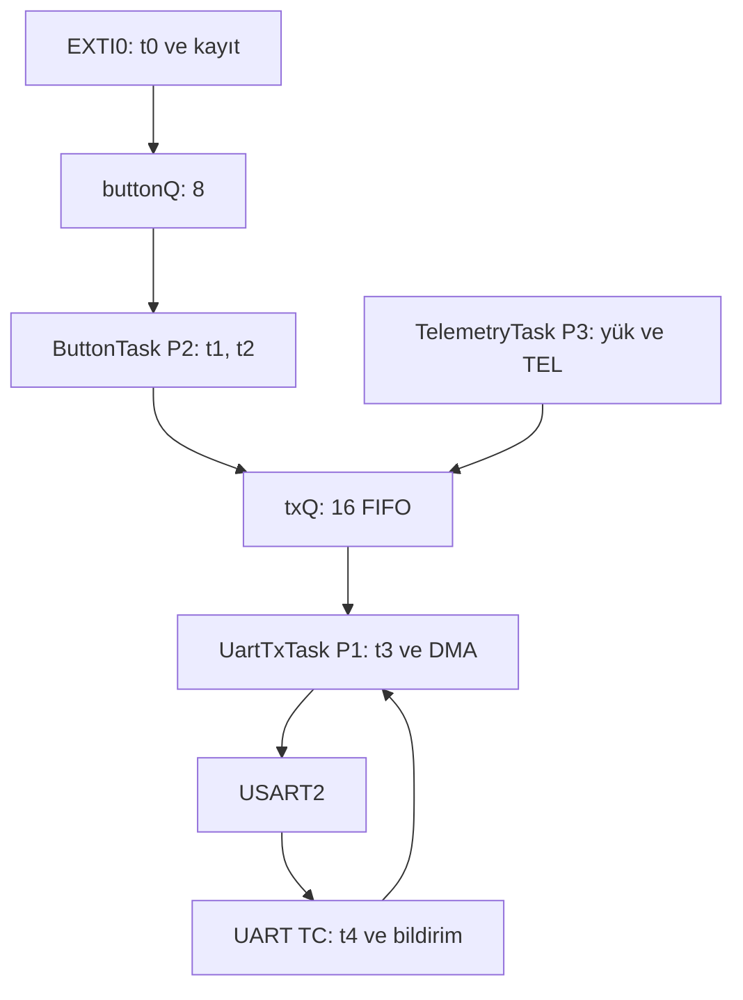
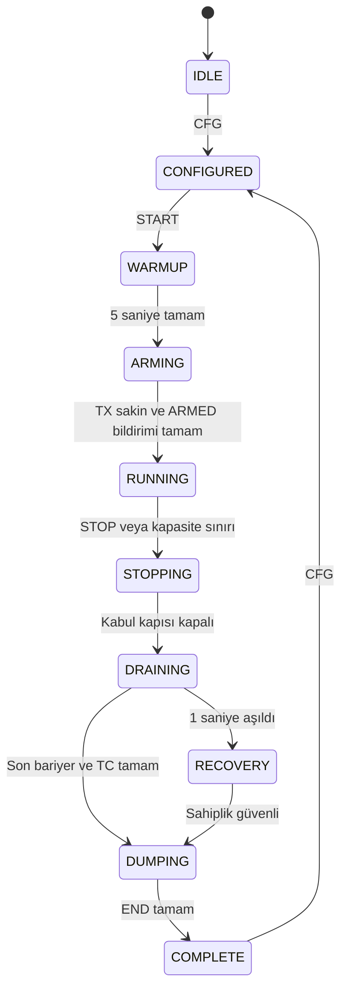

# FreeRTOS Bootcamp — Hafta 1 Specs v0.2

Birleştirilmiş okuma kopyası · 23 Eylül 2026

Temel kaynak: ödev ve teknik sunum HTML dosyaları. Mevcut proje: GitHub commit 7c6c83fbb21885d30aa82b25f9bd0821291346b4.

Bu dosya tasarım şartnamesidir; gerçek ölçüm veya uygulanmış firmware değildir.

- [FreeRTOS Bootcamp — Hafta 1 Specs v0.2](#spec-00)
- [01 — Sistem gereksinimleri](#spec-01)
- [02 — Firmware mimarisi ve sahiplik](#spec-02)
- [03 — Mevcut donanım ve CubeMX uyarlaması](#spec-03)
- [04 — Seri protokol PROTO2](#spec-04)
- [05 — PC arayüzü ve dosya çıktıları](#spec-05)
- [06 — Ölçüm, analiz ve kanıt sınırları](#spec-06)
- [07 — Doğrulama ve deney planı](#spec-07)
- [08 — Tasarım kararları ve v0.1 değişiklikleri](#spec-08)
- [09 — Kaynaklar ve inceleme izi](#spec-09)
- [10 — Mevcut proje incelemesi](#spec-10)
- [11 — Mevcut kurulumdan başlayan uygulama sırası](#spec-11)
- [12 — İster, tasarım ve doğrulama eşleştirmesi](#spec-12)


---

<a id="spec-00"></a>

# FreeRTOS Bootcamp — Hafta 1 Specs v0.2

**Tarih:** 23 Eylül 2026  
**Hedef:** STM32F407G-DISC1 / STM32F407VGT6, mevcut `Homework_001` projesi  
**İncelenen depo:** https://github.com/furkankara32/hafta-01  
**Başlangıç commit’i:** `7c6c83fbb21885d30aa82b25f9bd0821291346b4` — “Project Created”  
**Kullanıcının yerel kökü:** `D:\freertos-bootcamp\hafta-01`  
**Teslim:** 27 Eylül 2026 Pazar, 11.00 Türkiye saati (UTC+3).

## 1. Bu sürümün amacı

Kurulmuş STM32CubeIDE projesi ve eklenmiş kütüphaneler üzerinden, yük altında buton yanıt süresini ölçen ödevi tamamlamak için uygulanabilir sözleşme oluşturur. Proje yeniden kurulmayacak; eksik çevre birimi ayarları, uygulama kodu, PC arayüzü ve deney çıktıları eklenecek.

Bu paket bir **tasarım ve doğrulama şartnamesidir**. Firmware, arayüz veya gerçek deney sonucu içermez. Windows diskine doğrudan erişim bulunmadığı için mevcut durum incelemesi GitHub’daki belirtilen commit üzerinden yapılmıştır. Push edilmemiş yerel değişiklikler doğrulanmış sayılmaz. Kartta derleme/yükleme/ölçüm yapılmamıştır.

## 2. Kaynak önceliği ve kapsam

1. `odev-01.html`: ödevin bağlayıcı deney ve teslim isterleri.
2. `teknik-sunum.html`: zamanlama kavramları ve kanıt sınırları. Buradaki 5 ms, A/B/C izleri ve iki görevli örnekler bu ödevin sayısal isterleri değildir.
3. `index.html`: genel bootcamp ve teslim bağlamı. Nihai ödevin tarihi ve kapsamı için `odev-01.html` esas alınır.
4. Depodaki gerçek kernel/HAL kaynakları: kullanılabilir API ve callback davranışı.
5. v0.1 specs: korunacak proje tercihleri; resmi ödevin yerine geçmez.

Etiketler:

| Etiket | Anlam |
|---|---|
| **ÖDEV** | Kaynak şartnamenin zorunlu gereksinimi |
| **PROJE** | Bu uygulama için seçilen tasarım kararı; resmi ödev zorunluluğu değildir |
| **OPSİYONEL** | Temel ölçüm ve teslim tamamlandıktan sonra yapılabilir |

**PROJE hedefleri:** USART2 + DMA TX, TIM5 zaman tabanı, mevcut üç task iskeletinin korunması, PC’den senaryo seçimi, Python/PySide6 arayüzü ve Windows çalıştırılabilir paket. Son iki özellik v0.1’den korunmuştur. Ödevin kendisi arayüz dilini serbest bırakır ve derleme zamanı senaryo seçimine izin verir.

## 3. Okuma sırası

| Dosya | İçerik |
|---|---|
| [10_CURRENT_PROJECT_AUDIT.md](#spec-10) | Yapılmış kurulum, doğrulanmış eksikler, kaynak kanıtları |
| [01_SYSTEM_REQUIREMENTS.md](#spec-01) | Gereksinimler, sabitler, senaryolar |
| [03_HARDWARE_CUBEMX_SPEC.md](#spec-03) | Yalnız gerekli CubeMX ve RTOS uyarlamaları |
| [02_FIRMWARE_ARCHITECTURE.md](#spec-02) | Sahiplik, üç task, durdurma, kayıt ve hata akışı |
| [04_SERIAL_PROTOCOL_SPEC.md](#spec-04) | PROTO2 mesajları ve kesin veri sözleşmesi |
| [05_PC_INTERFACE_SPEC.md](#spec-05) | Arayüz, dosyalar, hata görünürlüğü |
| [06_MEASUREMENT_ANALYSIS_SPEC.md](#spec-06) | Ölçüm tanımları, istatistik ve yorum sınırları |
| [07_EXPERIMENT_TEST_PLAN.md](#spec-07) | Testler, S0–S5 deney prosedürü, teslim kontrolü |
| [08_DESIGN_DECISIONS.md](#spec-08) | Kararların gerekçeleri ve v0.1 düzeltmeleri |
| [09_SOURCES.md](#spec-09) | Kaynaklar ve inceleme sınırı |
| [11_IMPLEMENTATION_ROADMAP.md](#spec-11) | Mevcut kurulumdan başlayan iş sırası |
| [12_REQUIREMENT_TRACEABILITY.md](#spec-12) | İster → tasarım → doğrulama eşleştirmesi |

`PROJECT_SPECS_COMBINED.md` bu dosyaların birleştirilmiş okuma kopyasıdır. Değişiklikler numaralı dosyalarda yapılır, birleşik kopya yeniden oluşturulur. Depoda hedef konum `hafta-01/specs/`tir; ikinci bir `hafta-01` klasörü açılmaz.

## 4. Başlangıçta yapılacaklar

- TIM5’i 1 MHz, 32 bit serbest sayaç olarak ekle; TIM3 HAL timebase olarak kalsın.
- EXTI0 NVIC ve handler’ını ekle; olay kabulünü scheduler ve kuyruklar hazır olduktan sonra aç.
- Gerçek task önceliklerini 3/2/1 yap; mevcut CMSIS değerleri 40/24/8’dir.
- Mevcut FreeRTOS V10.3.1’de `vTaskDelayUntil()` kullan; `xTaskDelayUntil()` bu pakette yoktur.
- Sonra S0 için buton → kayıt → FIFO → UART TC zincirini tamamla.


---

<a id="spec-01"></a>

# 01 — Sistem gereksinimleri

**Sürüm:** v0.2. ÖDEV ve PROJE ayrımı [00_SPEC_INDEX.md](#spec-00) içindedir.

## 1. Değişmeyen deney sözleşmesi

| ID | Tür | Gereksinim |
|---|---|---|
| R01 | ÖDEV | Tek çekirdekte preemptive çalışma; üç uygulama görevi: TelemetryTask 3, ButtonTask 2, UartTxTask 1. Idle uygulama görevi değildir. |
| R02 | ÖDEV | `buttonQ=8`, `txQ=16`; FIFO. TEL ve BTN aynı TX kuyruğuna arkadan eklenir. |
| R03 | ÖDEV | UART 115200 baud, 8N1; TEL/BTN toplam **64 bayt**, LF bu 64 bayta dahildir. |
| R04 | ÖDEV | IT veya DMA TX; UartTxTask tamamlanmayı bloklanarak bekler. Tek UART TX sahibi odur. |
| R05 | ÖDEV | Yalnız basış kenarı; ilk kenar kabul; son kabulden itibaren 30 ms içindeki tekrarları say ve reddet. ISR kısa ve beklemesiz. |
| R06 | ÖDEV | Her kabul edilen kenara benzersiz olay kimliği ve t0 ver. Kuyruğa girmeden düşenlerin kimliği/t0’ı da korunur. |
| R07 | ÖDEV | t0…t4 aynı MCU saatinden; çözünürlük ≤1 µs; unsigned wrap hesabı. |
| R08 | ÖDEV | Yanıt `R=t4−t0`; deadline `R≤20,000 µs`. 1 s deney gözetim eşiği ayrı anlam taşır. |
| R09 | ÖDEV | En az 64 olaylık RAM kayıt alanı ve taşma sayacı; ana ölçümde kayıt dökümü yapılmaz. |
| R10 | ÖDEV | S0–S5; S0’da TelemetryTask bloklanır; diğerlerinde mutlak periyot tabanı. |
| R11 | ÖDEV | S4/S5 sabit iterasyonlu, optimizasyonla silinmeyen yaklaşık 2/5 ms hesaplama. Kesme kapatma veya delay ile yük üretme yok. |
| R12 | ÖDEV | Her senaryoda 5 s ısınma ve ≥30 kabul edilmiş basış, basışlar ≥0.5 s aralıklı ve değişken fazlı. |
| R13 | ÖDEV | Önce üretimi durdur, tüm önceki olayları ve TX’i tamamla veya timeout kaydet, ardından döküm yap. |
| R14 | ÖDEV | Her kabul edilen olay başarı/drop/TX hata/timeout veya kayıt kaybıyla hesap verilebilir; hata saklanmaz. |
| R15 | ÖDEV | PC port seçimi, bağlan/kes, TEL/BTN ayrımı, “Butona basıldı”, senaryo/olay kimliği, CSV, grafik ve kayıp görünürlüğü. |
| R16 | ÖDEV | Senaryo bazında min/ortalama/gözlenen max R, başarılı sayı, tamamlanmış geç yanıtlar ve ayrı hata sayıları. |
| R17 | ÖDEV | Olay→R + 20 ms çizgisi; senaryo→ortalama aşamalar yığılmış sütun; ham veriden tekrar üreten kod. |
| R18 | ÖDEV | Gerçek telemetri hızı, kuyruk yüksek su seviyesi, saat/tick/timer/derleme ayarları raporlanır. |
| R19 | ÖDEV | Firmware, interface, ham CSV, summary.csv, rapor, grafik, README, setup/code-notes/ai-usage dosyaları teslim edilir. |
| R20 | ÖDEV | Erişilebilir GitHub deposu, teslim commit SHA’sı; Telegram’a bağlantı ve çalışan sistemi anlatan kısa video. |

Deadline’ın bazı olaylarda aşılması ödevin otomatik olarak başarısız olması anlamına gelmez. İhlaller doğru ölçülüp açıklanmalıdır. 20 ms’yi aşan başarılı bir aktarımın status’u `ok` kalır; ayrıca `late_completed` sayacına girer. Hiç tamamlanmamış olay “zamanında yanıt” sayılmaz.

## 2. Zaman noktaları

| Nokta | Kaydetme sınırı |
|---|---|
| t0 | EXTI0 handler’ının ilk kullanıcı işlemlerinde timer okuma; filtre kabul ederse bu değer olaya bağlanır |
| t1 | ButtonTask’ın gerçek olay için başarılı queue receive dönüşünden hemen sonra |
| t2 | BTN için sıfır beklemeli `xQueueSend(txQ,…)` çağrısından hemen önce |
| t3 | BTN için `HAL_UART_Transmit_DMA()` çağrısından hemen önce |
| t4 | UART TC sonucundaki `HAL_UART_TxCpltCallback()` girişine yakın gözlem |

`t0` fiziksel kenar zamanı değildir. `t1` kesin Ready veya switch-in anı değildir. `t3` ilk fiziksel bit değildir. `t4` kesme/callback gözlem gecikmesini içerir. Eksik zamanlar geçerlilik maskesiyle temsil edilir; sıfır geçerli bir timer değeri olabilir.

## 3. Senaryolar ve hesaplanan bütçeler

| Senaryo | TEL | Periyot | Ek hesaplama/aktivasyon | Yalnız TEL hat kullanımı | Yaklaşık ek CPU talebi |
|---|---:|---:|---:|---:|---:|
| S0 | Kapalı | — | Yok | %0 | %0 |
| S1 | 10 Hz | 100 ms | Yok | %5.56 | %0 |
| S2 | 50 Hz | 20 ms | Yok | %27.78 | %0 |
| S3 | 100 Hz | 10 ms | Yok | %55.56 | %0 |
| S4 | 100 Hz | 10 ms | ≈2 ms | %55.56 | ≈%20 |
| S5 | 100 Hz | 10 ms | ≈5 ms | %55.56 | ≈%50 |

Bunlar teorik hesaplamalardır, gerçek ölçüm değildir. `64×10/115200=5.5556 ms` hat süresi. BTN ek trafik yaratır. CPU ve UART yüzdeleri farklı kaynaklara aittir ve toplanmaz. Ek hesaplamanın yokluğu görev maliyetinin sıfır olduğu anlamına gelmez.

## 4. Uygulama kararları

| ID | Tür | Karar |
|---|---|---|
| P01 | PROJE | Mevcut F407 projesi, USART2 PA2/PA3, normal mod TX DMA, TIM5 1 MHz. |
| P02 | PROJE | 128 ana kayıt + 8 acil taşma kaydı; slotlar koşu bitene kadar yeniden kullanılmaz. |
| P03 | PROJE | GUI’den CFG/START/STOP/DUMP; dördüncü uygulama görevi eklenmez. |
| P04 | PROJE | PROTO2, tüm MCU çıkış satırları 64 bayt; koşu kimliği, dump bütünlük kontrolü. |
| P05 | PROJE | Python + PySide6 + pyserial + matplotlib; Windows paketleme, kaynaklar da teslim. |
| P06 | PROJE | 2/5 ms kalibrasyon ortalaması için başlangıç hedefi ±%10; sağlanmazsa sapmayı açıkla ve yeniden kalibre et. Bu tolerans eğitmen şartı değildir. |
| P07 | PROJE | İstatistikte aynı geçerli `ok` olay kümesi kullanılır; bozuk/eksik transfer verileri ayrı kalite hatasıdır. |

## 5. Kapsam katmanları

**Önce:** güvenilir S0 zinciri, sonra altı senaryo, veri toplama ve iki grafik.  
**Korunan proje hedefi:** runtime senaryo kontrolü ve Windows paketleme.  
**Opsiyonel:** p95/median, karşılaştırma ekranı, t2a/t3q, input capture, kernel trace, açıklama paneli.

Mevcut ödev için ROS, MQTT, sensör, ek işlemci, internet bağlantısı veya bulut paneli gerekli değildir. Bu sürüm bu bileşenleri planlamaz.


---

<a id="spec-02"></a>

# 02 — Firmware mimarisi ve sahiplik

## 1. Üç görevli veri yolu



Yalnız UartTxTask fiziksel TX başlatır. Boot mesajı, ACK, durum ve dump da bu sahibin üzerinden geçer. TEL/BTN için öncelikli queue, öne ekleme veya UART mutex ile bağımsız gönderim yapılmaz.

## 2. Modüller ve sorumluluk

Tüm uygulama dosyaları mevcut `Src/Inc` altında yer alır. `freertos.c` task girişlerini uygulama fonksiyonlarına yönlendirir.

| Modül | Sorumluluk |
|---|---|
| `app_config.h` | Sabit boyutlar, öncelikler, senaryo tablosu |
| `app_measurement.c/h` | Kayıt rezervasyonu, timestamp geçerliliği, terminal durum, sayaç |
| `app_button.c/h` | Debounce, EXTI olayı, ButtonTask |
| `app_telemetry.c/h` | Mutlak periyot, TEL, iş yükü |
| `app_experiment.c/h` | Durum makinesi, komut işleme, kapılar ve bariyerler |
| `app_uart.c/h` | TX sahipliği, aktif DMA tamponu, callback ve RX satır toplayıcı |
| `app_protocol.c/h` | 64 bayt çerçeve kurma ve komut ayrıştırma |
| `app_time.c/h` | TIM5 okuma ve unsigned fark |

Bunlar önerilen dosya sınırlarıdır; aynı sorumlulukları koruyan daha az dosya kullanılabilir. ISR içinden heap, printf, GUI mantığı veya tam komut ayrıştırması yapılmaz.

## 3. Veri sözleşmeleri

- `ButtonEvent`: `kind` (PRESS/BARRIER), `run_id`, `event_id`, `record_index`, `t0_us`.
- `TxMsg`: `kind` (TEL/BTN/CONTROL/BARRIER), `run_id`, `event_id`, `record_index`, `uint8_t bytes[64]`. İç alanlar hatta gönderilmez; yalnız bytes gönderilir.
- `Measurement`: `run_id`, `event_id`, `t[5]`, `valid_mask`, `stage`, `status`, `reason`.
- `ActiveTx`: task-owned 64 bayt tampon, mesaj türü, kayıt kimliği, `generation`, aktif/abort durumu.

Queue elemanları **değerle kopyalanır**. Pointer ile gönderilecek her şeyin ömrü ayrıca kanıtlanmalıdır; ilk uygulamada pointer mesajı kullanılmaz. `valid_mask` bit 0…4 t0…t4’ün mevcut olduğunu belirtir. `status=pending` yalnız RAM içidir; son dump’ta kalamaz. `reason` detayları ayrı diagnostic dosyaya çıkabilir, zorunlu CSV alanları korunur.

`event_id` koşu içinde 1’den başlayan uint32; `run_id` her başarılı START ile artar. Kart resetinde run sayaçları sıfırlanabilir; PC oturum kimliği bunu ayırır. UINT32 sınırına ulaşılırsa yeni koşu açılır; kimlik sessizce sarılmaz.

## 4. Kayıt havuzu ve kayıp hesabı

128 ana slot ve 8 acil kayıt (PROJE). Her koşu için slotlar monoton atanır, koşu bitmeden geri kullanılmaz. ISR **queue send’den önce** slotu ayırır; id/t0/valid_mask ve başlangıç durumunu yayımlar. `buttonQ` dolarsa aynı slot `button_q_drop` ile kapanır. Böylece kuyruk dışında düşen olay da kaybolmaz.

Ana havuz dolduktan sonraki ilk kabul edilen olay acil slotta `record_overflow` olur: id/t0 saklanır, `record_overflow` artırılır, olay kabul kapısı hemen kapanır ve kontrollü STOP istenir; koşu sonucu INCOMPLETE olur. Bu olayın BTN yanıtı üretilmez. Kapı kapandıktan sonraki kenarlar kabul edilmiş olay sayılmaz; `outside_run_edges` tanısında tutulabilir. Acil slotun da kullanılamadığı savunma yolunda `unrecorded_events` artırılır ve koşu INCOMPLETE sayılır; olmayan satır uydurulmaz.

Döküm sonunda, kayıt kaybı yoksa:

`accepted = ok + button_q_drop + tx_drop + tx_error + timeout + record_overflow`

Ek koruma yolu çalıştıysa sağ tarafa `unrecorded_events` eklenir. TEL drop sayıları bu eşitliğe girmez. 30 hedefi PC’de görülen BTN sayısı değil, MCU `accepted` sayısıdır.

### Yazma sahipliği

| Alan | Normal yazar |
|---|---|
| id, t0, slot tahsisi, debounce | EXTI0 |
| t1, t2, TX queue drop | ButtonTask |
| Aktif transfer, t3, başlatma hata bilgisi | UartTxTask |
| t4, TC terminal geçişi | USART2 TX complete callback |
| Ölçüm kapısı, run config, kontrol durumları | TelemetryTask kontrol bölümü |

Terminal geçiş tek seferliktir. Callback ve timeout yarışında kısa task/ISR uyumlu kritik bölge içinde slot/run/generation ve pending durumu kontrol edilir. Terminal olmuş kayda sonraki callback yazamaz. `volatile` tek başına eşzamanlılık çözümü değildir. Uzun bloklama, formatlama veya DMA başlatma kritik bölge içine alınmaz. Döküm yalnız üreticiler ve aktif callback sahipliği sakinleştikten sonra salt okunur tabloda çalışır.

## 5. Task akışları

### TelemetryTask P3

IDLE/COMPLETE/S0’da kontrol kuyruğu bildirimi veya durum zaman aşımı için bloklanır. S0 ölçüm penceresinde boş döngü çalışmaz. S1–S5’te başlangıçta `last=xTaskGetTickCount()`; her çevrimde sabit iterasyonlu iş → 64 bayt TEL oluştur → `xQueueSend(txQ,…,0)` → `vTaskDelayUntil(&last, period)`.

TEL seq her üretim denemesinde artar, başarısız enqueue `tel_q_drop` sayılır. Gerçek aktivasyon başlangıç zamanları ve aralık istatistikleri formatlamadan önce örneklenir. Periyot aşımında “kaçırılmış planlı aktivasyon” sayılır; tick tabanı sessizce now’a taşınmaz. Catch-up davranışı raporlanır. Böyle bir aşım sık görülüyorsa koşu nominal 100 Hz diye sunulmaz.

Komut satırları küçük bir `controlQ` (4×en fazla 64 B) üzerinden alınır. ISR sadece satırı kopyalar ve bu task’ı bildirir. RUN’da geçerli komut STOP’tur; durum değiştiren CFG/START reddedilir ve yanıtı ölçüm kapanışından sonraya bırakılır. GUI RUN’da HELLO/polling yapmaz.

`vTaskDelayUntil` beklemesini task notification kesmez. S1’de STOP işleme gecikmesi yaklaşık bir periyot kadar olabilir; kuyruktaki komut bir sonraki çevrimin **başında** işlenir, sonra yeni TEL üretimine karar verilir. RUN sonu zamanı PC’nin STOP yolladığı zaman değil, MCU’nun kabul kapısını kapattığı zamandır. S0 notification bekleyişi STOP ile uyanır.

### ButtonTask P2

`xQueueReceive(buttonQ,…,portMAX_DELAY)` ile bloklanır. PRESS ise hemen t1 alınır; run/slot eşleşmesi doğrulanır. BTN oluşturulur, t2 alınır ve `xQueueSend(txQ,…,0)` denenir. Dolulukta `tx_drop`, formatlama gibi gönderim öncesi iç hatada `tx_error` + detay nedeni kaydedilir. Sonraki mesaj beklenir. Periyodik polling yoktur.

BARRIER ise önceki PRESS olaylarının tümü bu task tarafından terminal hale getirilmiş veya txQ’ya bırakılmıştır. Task, `TX_BARRIER` mesajını txQ **sonuna** kalan durdurma bütçesiyle ekler. Kontrol bariyeri için sonlu bloklanma kabul edilir; TEL/BTN enqueue çağrıları yine sıfır beklemelidir.

### UartTxTask P1

Kuyruktan mesaj alır, tek aktif kalıcı tamponuna kopyalar. BTN için t3’ü kaydeder, DMA başlatır. HAL_OK ise notification ile TC/hata/zaman aşımı bekler. Tamamlanmadan yeni mesaj alamaz veya tamponu değiştiremez. Callback daha task beklemeye başlamadan gelse de notification saklanmış olmalıdır; başlangıçtan sonra körlemesine notification temizlenmez.

Idle’da txQ üzerinde bloklanır. Kontrol ve dump mesajlarını da aynı DMA-TC yardımcı akışıyla gönderir. Dump ana ölçüm dışında olduğundan veriyi doğrudan kayıt tablosundan sırayla biçimleyebilir; 128 kaydın hepsini txQ’ya doldurması gerekmez.

## 6. Durum makinesi ve ısınma



START öncesi önceki TX/RX komut durumları sakin olmalı. Koşu ayarları donmuş bir config kopyasına alınır. Isınmada butonlar deney kaydına alınmaz; sayaçlar warmup ve run olarak ayrıdır.

5 s ısınma bitince TEL geçici durur, önceki TX drain edilir; durum mesajları tamamlanır. Kuyruklar boşken ölçüm sayaçları/slotlar sıfırlanır, debounce ilk-olay durumu yeniden kurulur. `EXP,ARMED` TX tamamlanması kontrol task’ına bildirilir; task tek tutarlı geçişte `run_start_us`, RUNNING ve kabul kapısını açar, periyot tabanını yeniden kurar. Bu küçük geçişin süresi setup/metadata’da açıklanır; ısınma örnekleri ham CSV’ye katılmaz. PC, ARMED bildirimi geldikten sonra kullanıcıya basış yönergesi gösterir.

## 7. STOP bariyeri: iki üreticiyi de durdur

Eski v0.1’de TelemetryTask’ın tek başına txQ’ya marker bırakması yetersizdi: buttonQ’da bekleyen bir olay marker’dan sonra BTN üretebilirdi.

Yeni sıra:

1. TelemetryTask kısa kritik geçişte `measurement_enabled=false` yapar ve `run_stop_us` kaydeder. EXTI0 bundan sonra yeni deney olayı kabul etmez. Daha önce girmiş ISR bu geçişten önce tamamlanmış olur.
2. TelemetryTask yeni TEL üretimini keser; `BUTTON_BARRIER` mesajını buttonQ sonuna ekler.
3. ButtonTask kendinden önceki olayları işler; ardından `TX_BARRIER` mesajını txQ sonuna ekler. Bu anda her iki veri üreticisi de durmuştur.
4. UartTxTask her önceki mesajın TC’sini bekleyerek ilerler. TX_BARRIER’a ulaştığında aktif veri aktarımı kalmamıştır.
5. Bütün kayıtlar terminal ise sayaç/metadata snapshot alınır ve dump başlar. Pending kalanlar açıklanıp terminalleştirilmeden dump tamamlanmış sayılmaz.

Bariyer byte göndermez, gerçek ölçüm mesajı sayılmaz. Queue uzunluklarını değiştirmez. Kuyruk reseti veya tablo temizliği bu akış bitmeden yapılmaz. Aynı barriyer yaklaşımı ARMING’de üreticileri sakinleştirmeye yardımcı olabilir.

## 8. Timeout ve hata davranışı

**20 ms deadline:** yalnız ölçüm sonucu sınıflandırması; TX’i 20 ms’de iptal etmez.  
**1 s gözetim:** ödevin deney timeout’u. Tek aktif transfer bekleyişi sınırsız olamaz. BTN’nin kuyruk yaşı, servis edildiğinde t0’dan itibaren kontrol edilir; aktif transfer beklemesi kalan olay bütçesini aşmaz. TEL için TC beklemesi en fazla 1 s. STOP’taki tüm bariyer/drain işlemleri için ayrı **tek toplam 1 s bütçe** tutulur; her mesajda yeni bir saniye eklenmez.

HAL_BUSY/HAL_ERROR başlangıç sonucu: ilgili BTN `tx_error`, t4 eksik. UART TX/DMA hatası: callback task’a bildirir; yalnız gerçekten TX’i etkileyen hata aktif BTN’yi kapatır. RX framing/overrun hatası otomatik olarak TX hatası sayılmaz.

Timeout sonrası yalnız `status=timeout` yazıp yeni DMA başlatmak yeterli değildir. Aktif transfer abort edilir; ilgili DMA/UART TC kesmesi ve bekleyen bildirimler temizlenir; HAL ve donanımın tekrar hazır olduğu doğrulanır. Abort callback’i TX completion gibi kullanılmaz. Eski kesmenin yeni `ActiveTx` kaydını kapatamaması sağlanır. Hata giderilemezse yeni TX durur, RAM korunur; cihaz yeniden bağlandığında dump kurtarma denenir. Sahiplik güvenli olmadan dump yapılmaz.

Drenaj başarısızlığında üreticiler önce sakinleşir; kuyrukta kalan ve aktif olaya ait terminalleşmemiş BTN’ler timeout ile kapanır. TC daha önce kaydı ok olarak kapatmışsa timeout bunu üzerine yazamaz. Koşu sonucu INCOMPLETE olur. Bu yazılım gözetimi, tüm CPU’nun kilitlendiği durumda bağımsız donanım watchdog garantisi vermez.

## 9. Sayaçlar ve ölçüm penceresi

Minimum MCU sayaçları: `accepted`, `debounce_reject`, `button_q_drop`, `btn_tx_drop`, `tel_q_drop`, `uart_tx_error`, `tx_timeout`, `drain_timeout`, `record_overflow`, `unrecorded_events`, `txq_hwm`, `buttonq_hwm`, `tel_generated`, `tel_enqueued`, `tel_completed`, `rx_error`, `control_drop`, `format_error`, `period_overrun`.

Sayaç güncellemelerinde tek-yazar veya kısa korumalı okuma/değiştirme kullanılır. HWM queue wrapper’larında enqueue ve doluluk gözlemiyle tutarlı tutulur; örneklenmiş alt sınırsa öyle etiketlenir. Aktif DMA mesajı txQ doluluğuna dahil değildir. ARMING/kontrol/bariyer ve dump trafiği ölçüm HWM’sine ve TEL sayımlarına karışmaz.

Gerçek TEL üretim hızı için run içindeki ilk/son aktivasyon, aktivasyon sayısı ve min/max/toplam periyot aralıkları tutulur. `tel_completed` koşuya ait bütün TEL’lerin drain sonundaki sayısıdır; bunun run süresine oranı tek başına üretim frekansı diye etiketlenmez.

Sayaç kapsamı: `uart_tx_error`, dump öncesi snapshot’a kadar başarısız TX başlatma/aktarımı sayar; aynı aktif mesajın tekrar hata callback’leri bir kez sayılır. `tx_timeout` yalnız aktif TX’in TC bekleyişinin zaman aşımı sayısıdır. Henüz TX’e başlamamış bir BTN’nin olay bütçesi dolarsa CSV status=timeout olur fakat tx_timeout artmaz. `drain_timeout` 1 s toplam kapanış bütçesi aşıldığında bir kez artar. Bu nedenle genel TX sayaçları ile BTN status sayıları birebir eşit olmak zorunda değildir. Dump’ın kendi alım/gönderim hataları snapshot sonrasındadır; PC kalite kaydında ve cihazın sonraki tanı bilgisinde ayrıca korunur.


---

<a id="spec-03"></a>

# 03 — Mevcut donanım ve CubeMX uyarlaması

## 1. Korunacak temel

Mevcut `firmware/Homework_001` açılır. HAL/CMSIS/FreeRTOS kütüphaneleri tekrar indirilmez. Pinler: PA0 buton, PA2 USART2 TX, PA3 USART2 RX. Harici 3.3 V lojik USB-UART için PA2→RX, PA3←TX, GND↔GND. ST-LINK VCP bağlantısı kart revizyonuna bağlı olarak ayrıca kablolama gerektirir; mevcut seri adaptörle ilerlemek uygundur (UM1472 §7.3.3).

Mevcut clock planı: 8 MHz HSE → 168 MHz SYSCLK/HCLK; APB1=/4 → 42 MHz ve timer clock=84 MHz. Saat ayarı değişirse PSC tekrar hesaplanır.

## 2. Üç zaman tabanını ayır

| Kaynak | Görev | Hedef |
|---|---|---|
| SysTick | FreeRTOS scheduler tick’i | 1000 Hz |
| TIM3 | HAL tick / HAL_GetTick | Mevcut 1 ms |
| TIM5 | t0…t4 ve ölçüm zamanları | 1 MHz, 32 bit free-running |

TIM3’ü yeniden amaçlandırma. `HAL_GetTick()` veya RTOS tick’i 1 µs gereksinimini karşılamaz.

TIM5: Internal Clock, up counter, `PSC=84 MHz/1 MHz−1=83`, `ARR=0xFFFFFFFF`, clock division DIV1. Update IRQ gerekmez. PA0/PA2/PA3 için TIM5 channel alternate function açılmaz; base timer pin istemez.

`MX_TIM5_Init()` sonrası, scheduler başlamadan `HAL_TIM_Base_Start(&htim5)` sonucu kontrol edilir. `timer_us()` CNT okur. Sayaç koşular arasında sıfırlanmaz; kayıt başlangıcı ayrı saklanır. Bir tur 4294.967296 s ≈71.58 dakikadır. Resmi koşuyu 10 dakikayla sınırlandırmak PROJE kararıdır; süresi dolunca kontrollü STOP uygulanır.

## 3. EXTI0

PA0 rising/no-pull mevcut ayarı korunur; gerçek kartta basışta yükselen kenar geldiği doğrulanır. NVIC EXTI0 priority=5, subpriority=0 eklenir. Handler’da ilk kullanıcı işlemlerinden biri t0 adayını okumaktır. Zaman damgasını yalnız `HAL_GPIO_EXTI_Callback` içinde almak handler girişindeki gecikmeyi kaçırır; girişteki değer callback’e taşınır veya tek bir özel EXTI işleyicisi kullanılır. EXTI pending flag yalnız bir yerde temizlenir.

Olay kabulü `measurement_enabled` kapısı üzerinden açılır. Kuyruklar, timer ve task handle’ları hazır değilken ISR FreeRTOS API çağırmaz. Tercih: scheduler çalıştıktan sonra init tamamlanınca pending flag temizle ve EXTI0’ı aç. CubeMX erken enable üretirse bunun hemen ardından güvenli init sırasında maskelenmesini ve kapı kontrolünü birlikte sağla.

## 4. Öncelik ve API uyarlaması

Mevcut üç `osThreadNew` çağrısı ve scheduler başlangıcı korunur. `MX_FREERTOS_Init` içindeki `USER CODE BEGIN RTOS_THREADS` alanında üç handle için NULL kontrolünden sonra:

```c
vTaskPrioritySet((TaskHandle_t)TelemetryTaskHandle, 3U);
vTaskPrioritySet((TaskHandle_t)ButtonTaskHandle,    2U);
vTaskPrioritySet((TaskHandle_t)UartTxTaskHandle,    1U);
```

Ardından `uxTaskPriorityGet` ile 3/2/1 doğrulanır. Bu dönüşüm depodaki ST CMSIS wrapper’ının handle eşlemesine dayanır; genel CMSIS taşınabilirliği iddiası değildir. `configMAX_PRIORITIES=56` mevcut haliyle kalabilir. Ödev en az 4 ister, tam 4 zorunlu değildir.

Task gövdelerinde native queue/notification API’leri kullanılır. Aynı task notification alanı CMSIS thread flags ile paylaşılmaz. İkinci kez `xTaskCreate` ile aynı görevler oluşturulmaz. `configUSE_TIMERS=1` nedeniyle kernel timer görevi bulunabilir; uygulama software timer’ı eklenmez, görev ölçümde bloklanmış olmalıdır.

V10.3.1’de `vTaskDelayUntil(&last, period)` mevcut API’dir. `INCLUDE_vTaskDelayUntil=1` korunur. Güncel sunumdaki `xTaskDelayUntil` adı için kernel güncelleme zorunluluğu yaratılmaz. Bu uyarlama aynı mutlak periyot amacını karşılar, README’ye açıklama eklenir. Her START/senaryo başlangıcında `last=xTaskGetTickCount()` yeniden kurulur; her döngüde sıfırlanmaz.

## 5. NVIC sözleşmesi

| IRQ | Preemption | RTOS çağrısı |
|---|---:|---|
| EXTI0 | 5 | Queue send FromISR, yield |
| USART2 | 5 | TX notify / RX queue FromISR |
| DMA1 Stream6 | 5 | HAL TX işlemleri; hata bildirimi gerekebilir |
| DMA1 Stream5 | 5 | Mevcut RX DMA kullanılmıyorsa transfer başlatılmaz |
| SysTick / PendSV | 15 | Kernel |
| TIM3 | Mevcut 15 | HAL tick, RTOS API yok |

Grouping=NVIC_PRIORITYGROUP_4, `configLIBRARY_MAX_SYSCALL_INTERRUPT_PRIORITY=5`. Bu konfigürasyonda FromISR kullanan kullanıcı IRQ’larının sayısal önceliği ≥5 olmalı. Küçük NVIC sayısı daha güçlü kesme, büyük task sayısı daha güçlü task demektir. Mevcut güvenli UART/DMA=5 değerlerini sırf v0.1 önerisi 6 idi diye değiştirmek gerekmez.

## 6. TX ve RX

TX: DMA1 Stream6 Channel4, NORMAL, byte alignment, memory increment; USART2 global IRQ açık. Aktif 64 bayt tampon ordinary SRAM’de tutulur; DMA’nın erişemediği CCM RAM’e konmaz. DMA bitmeden ve hata halinde abort tamamlanmadan tampon yeniden kullanılmaz.

RX için PROJE kararı: düşük hacimli komutlarda `HAL_UART_Receive_IT(...,1)` ile byte alımı. Mevcut RX DMA konfigürasyonu kullanılmadan kalabilir; aynı anda IT ve DMA RX başlatılmaz. ISR sadece sınırlı byte/line toplama, hazır satırı queue’ya kopyalama, rearm ve notify yapar. Sayı/komut/durum doğrulaması TelemetryTask’tadır. Normal RX DMA tercih edilirse rearm boşluğu ve HT/TC/IDLE çift işleme ayrıca çözülmelidir; v0.2’nin temel yolu IT RX’tir.

## 7. Bellek ve derleme

Önerilen ilk stack bütçeleri (PROJE başlangıç değeri): TelemetryTask 512 word=2048 B, ButtonTask 256 word=1024 B, UartTxTask 512 word=2048 B. CMSIS `stack_size` bayt, native stack depth `StackType_t` birimidir. Bunlar yeterlilik garantisi değildir; tüm senaryolar, dump ve hata yollarında high-water ölçülür. 15 KB FreeRTOS heap bütçesi task/queue/newlib maliyetleriyle `.map` ve minimum free heap üzerinden kontrol edilir; gerekirse gerekçeyle artırılır. Kayıt tabloları static SRAM’de tutulabilir.

`configCHECK_FOR_STACK_OVERFLOW=2`, malloc failure hook ve mevcut assert aktif olacak şekilde kullanıcı alanları/CubeMX üzerinden kurulur. Hook içinde UART printf veya bloklama yapılmaz. Dinamik task/queue tahsisi yalnız başlangıçta; olay başına malloc yok. Newlib reentrancy mevcut haliyle korunur; float formatlama kullanılmaz.

Tüm resmi koşularda aynı ELF, optimizasyon, clock ve enstrümantasyon kullanılır. Kalibrasyon bu ELF ile yapılır. Debugger breakpoint/single-step açıkken ölçüm alınmaz; debug halt timer davranışını da etkileyebilir. `SystemCoreClock`, RCC SWS/PLL ve SYSCLK sonrası `SysTick->LOAD` kontrol edilir; CPU clock 168 MHz ve SysTick HCLK ise 1 kHz için LOAD=167999 beklenir.

## 8. Yeniden üretim kontrolü

CubeMX generate sonrası USER CODE alanlarının, öncelik uyarlamasının ve ayrı uygulama dosyalarının korunduğunu kontrol et. Dosya yapısı `Src/Inc` olarak kalır; varsayımsal `Core/Src` yollarına kod yerleştirme. Tek SVC, PendSV, SysTick handler’ı olduğundan emin ol. Build log, `.map`, CubeMX ve compiler sürümlerini `docs/setup.md` içine kaydet.


---

<a id="spec-04"></a>

# 04 — Seri protokol PROTO2

## 1. Çerçeve

Bu sürüm v0.1’in belirsiz SUM alanlarını ve koşu kimliği eksikliğini giderir. Firmware ve GUI PROTO2’yi birlikte uygular; PROTO1 ile karıştırmaz.

MCU→PC tüm satırlar: ASCII payload en fazla 63 B, kalan alan `0x20` boşluk, **byte[63]=0x0A**. Toplam 64 B, ekstra CR veya NUL gönderilmez. Formatlama için geçici C tamponu en az 64 B (63+NUL) olabilir; UART tamponuna NUL taşınmaz. `snprintf` dönüşü negatifse veya >63 ise hata, sessiz kesme yok.

Sayılar işaretsiz ondalık uint32 (0…4294967295); command request kimliği uint16 (1…65535). CRC alanı 8 hex karakter. Eksik timestamp `-`, gerçek sıfır `0`dır. Satırlardaki tüm semboller ASCII’dir; “Butona basıldı” yalnız GUI metnidir.

PC→MCU LF sonlandırmalı en fazla 63 karakter + LF. CRLF gelirse tek CR kaldırılabilir. RX satırı fazla uzunsa LF’ye kadar atılır, `control_drop/format_error` görünür olur. ISR’de sınırlı toplama; parsing TelemetryTask’ta.

## 2. Kontrol komutları

```text
HELLO,<req>
CFG,<req>,S0
START,<req>
STOP,<req>
DUMP,<req>
```

CFG S0…S5 kabul eder. v0.1’de belirsiz kalan RESET ve ABORT temel protokolden çıkarılmıştır. WARMUP’ı iptal etmek için STOP da desteklenir; bu koşu `CANCELLED`, resmi veri seti olarak kullanılamaz.

| Komut | İzinli durum | Davranış |
|---|---|---|
| HELLO | IDLE/CONFIGURED/COMPLETE | Sürüm ve mevcut durum |
| CFG | IDLE/CONFIGURED/COMPLETE | Yeni senaryo, kayıtları henüz silmez |
| START | CONFIGURED | Önceki kayıt kaydedildikten sonra yeni run; warmup başlar |
| STOP | WARMUP/ARMING/RUNNING | Kontrollü kapanış; RUN’daki ACK/status drain sonrasına bırakılır |
| DUMP | COMPLETE | RAM’deki aynı koşuyu tekrar gönderir; yeni ölçüm oluşturmaz |

Yanıtlar:

```text
SYS,RTOSLAT,FW02,PROTO2
ACK,<req>,<cmd>,<run>
ERR,<req>,<code>
EXP,<run>,<state>,<scenario>
```

Durumlar: IDLE, CONFIGURED, WARMUP, ARMED, DUMPING, DONE, INCOMPLETE, CANCELLED. İç STOPPING/DRAINING geçişleri RUN trafiğine ekstra satır eklemek için kullanılmaz. `run=0` henüz run yok anlamına gelir. ERR kodları: BAD_CMD, BAD_ARG, BAD_STATE, BUSY, NO_DATA, INTERNAL.

GUI aynı anda tek komut bekletir. Timeout önerisi: CFG/HELLO/START 2 s, STOP 3 s (MCU drain bütçesi 1 s), dump inactivity 2 s/toplam 15 s. Bunlar PC kontrol süreleridir; 20 ms deadline veya MCU 1 s gözetimi değildir. GUI timeout’ta START’ı yeni request id ile otomatik tekrarlamaz. Son tamamlanan request’in komut ve yanıtı cache’lenir; aynı req+aynı içerik yeniden gelirse işlem tekrar yapılmadan yanıt döner. Aynı req+farklı içerik BAD_ARG; hala işlenen aynı req ikinci işlem başlatmaz. RUN sırasında yanlış komutun ERR’si kapanışa kadar ertelenir. Request kimliği oturum içinde tekrar kullanılmaz; sınırda yeniden bağlantı kurulur.

## 3. Canlı ölçüm mesajları

```text
TEL,<run>,<scenario>,<seq>,<value>
BTN,<run>,<scenario>,<event_id>,PRESSED
```

`value` ucuz, deterministik uint32 demo değeridir; gerçek sensör zorunluluğu yoktur. BTN t4 taşımaz. GUI gelen BTN sayısını gösterir, bunu kabul edilen kenar sayısı diye sunmaz. Run kimliği ve senaryo eşleşmezse satır raw log’a gider, mevcut deneyde kullanılmaz.

## 4. Döküm sırası ve kayıt birleştirme

Döküm kontrol task’ı yeni ölçümü kapattıktan, iki üretici ve TX sakinleştikten sonra başlar:

```text
BEGIN,<run>,<scenario>,<record_count>,<last_event_id>
MET,<run>,<key>,<value>
SUM,<run>,<key>,<value>
M1,<run>,<event_id>,<t0>,<t1>,<t2>
M2,<run>,<event_id>,<t3>,<t4>,<status>
END,<run>,<record_count>,<crc32>
```

MET ve SUM satırları kendi tablolarındaki her anahtar için tekrarlanır. M1 ve M2 her olay için id sırasıyla ardışık üretilir. `record_count` taşma acil kayıtları dahil gerçek satır sayısıdır. PC anahtarı `(connection_session_id, run_id, event_id)`dir. Tam dump alınmadan resmi `Sx.csv` oluşturulmaz. Kaynakta bir kaydın yalnız yarısı varsa geçici sonuç INCOMPLETE kalır; eksik parça gerçek MCU drop’u gibi gösterilmez.

Status kümesi:

| Status | Beklenen geçerli zamanlar |
|---|---|
| ok | t0…t4 tam |
| button_q_drop | yalnız t0 |
| tx_drop | t0,t1,t2 |
| tx_error | hata yerine göre t0’dan başlayan kısmi zincir, t4 yok |
| timeout | zaman aşımının yerine göre kısmi zincir, t4 yok |
| record_overflow | yalnız t0, acil kayıt |

Örnekler yalnız **biçim örneğidir**, donanım sonucu değildir. En uzun uint32 değerleriyle payload uzunluğu doğrulanır; M1/M2 63 karakteri geçmez.

## 5. Metadata (MET)

Key en fazla 20 ASCII karakter; value en fazla 24 ASCII karakter, virgül/LF/CR içermez. Tam firmware SHA iki adet 20 karakterlik `fw_sha_a`, `fw_sha_b` alanıyla aktarılır. Derleme kimliği ayrıca PC metadata dosyasına tam yazılır.

Zorunlu anahtarlar:

| Key | Birim/anlam |
|---|---|
| sysclk_hz, timer_hz, tick_hz | Hz |
| baud, frame_bytes | 115200, 64 |
| prio_tel, prio_btn, prio_tx | 3,2,1 |
| buttonq_len, txq_len | 8,16 |
| record_capacity | Ana havuz: 128 |
| telemetry_hz, period_ms | Konfigüre değer; S0’da 0 |
| work_target_us, work_iters | Hedef ve sabit iterasyon |
| work_min_us, work_mean_us, work_max_us | Kalibrasyon sonucu; ölçülmediyse `-` |
| run_start_us, run_stop_us | Kabul kapısı sınırları |
| tel_first_us, tel_last_us | Run içi aktivasyon sınırları; yoksa `-` |
| period_min_us, period_max_us | Aktivasyon farkları; <2 aktivasyonda `-` |
| period_sum_us, period_n | Toplam fark ve fark sayısı; run ≤10 dk olduğundan uint32 içinde |
| fw_sha_a, fw_sha_b | Derlenen kaynak commit’i; bilinmiyorsa `unknown` |
| build_config, opt_level | Örn. Release / Os; gerçek build’den |
| kernel_version | V10.3.1 |
| result | COMPLETE, INCOMPLETE veya CANCELLED |

Kart seri bilgisi, IDE/GCC/Python/library sürümleri, USB-UART modeli ve kalibrasyon yöntemi `Sx_meta.json` içinde host tarafından eklenir; tahmin edilmez. PROTO2 sürümü dosyaya yazılır.

## 6. Sayaçlar (SUM)

Key ≤20 karakter, value uint32. Minimum anahtarlar:

`accepted`, `ok`, `late_completed`, `debounce_reject`, `button_q_drop`, `btn_tx_drop`, `tel_q_drop`, `uart_tx_error`, `tx_timeout`, `drain_timeout`, `record_overflow`, `unrecorded_events`, `txq_hwm`, `buttonq_hwm`, `tel_generated`, `tel_enqueued`, `tel_completed`, `rx_error`, `control_drop`, `format_error`, `period_overrun`.

`uart_tx_error` snapshot’a kadar başarısız TX başlatma/aktarımı sayar; aynı mesajdaki tekrar callback’ler bir kez sayılır. `tx_timeout` yalnız aktif aktarımın TC bekleme timeout sayısıdır; TX başlamadan süresi dolan BTN bunun içinde değildir. `drain_timeout` toplam kapanış bütçesi aşım sayısıdır. CSV’deki BTN tx_error/timeout sayıları ayrıca hesaplanır; genel sayaçlar üstüne tekrar toplanmaz. `ok/late_completed` biten BTN kayıtlarından snapshot sırasında hesaplanabilir. Bilinmeyen SUM key’leri raw log’da korunur.

## 7. Bütünlük ve tekrar dump

CRC-32/ISO-HDLC, Python `zlib.crc32` ile uyumlu: başlangıç API accumulator=0, M1/M2’nin gönderildiği sıradaki **tam 64 baytları** art arda işlenir, unsigned32 sonuç 8 haneli hex yazılır. BEGIN/MET/SUM/END CRC’ye dahil değildir; bunlarda beklenen anahtar seti, tekil key’ler, run kimliği ve sayaç eşitlikleri ayrıca doğrulanır.

Eksik/çelişen duplicate M1/M2, sıra bozukluğu, CRC uyumsuzluğu veya BEGIN/END sayı farkı dump’ı geçersiz yapar. Aynı kayıtların yeniden dökümü yeni BEGIN ile ayrı denemedir; önceki yarım dump’la sessiz birleştirilmez. Firmware COMPLETE kaydını yeni başarılı START’a kadar saklar. GUI yeni START öncesi önceki verinin kaydını doğrular.

## 8. Parçalı alım

Her `read()` sıfır, yarım veya birçok frame getirebilir. Bytes buffer’a eklenir, LF sınırları ayrılır ve LF dahil 64 bayt doğrulanır. LF yokken buffer üst sınırını aşarsa resync modunda bir sonraki LF’ye kadar at, framing error say. Raw bytes korunur. Padding yalnız payload sonundan kaldırılır; CSV alanları ve `-` işareti kaybolmaz. Bu kurallar PC ve test fixture’larında aynı olmalıdır.

MCU mean metadata alanları en yakın tam mikro saniyeye yuvarlanır; host özetindeki ortalamalar ham veriden ondalıklı hesaplanır. DUMP tekrarında GUI yeni request kimliği kullanır; aynı request tekrarının idempotent ACK davranışı yeni döküm talebi yerine geçmez.


---

<a id="spec-05"></a>

# 05 — PC arayüzü ve dosya çıktıları

## 1. Hedef ve teknoloji

Arayüz kullanıcıya bağlantı, senaryo, canlı BTN yanıtı ve deney sonuçlarını gösterir. MCU response time PC’de ölçülmez; t0…t4 dump’tan gelir. Ekranın güncellenme gecikmesi R’ye katılmaz.

PROJE tercihi: Python 3.12 ortamı, PySide6, pyserial, matplotlib. pandas isteğe bağlıdır; `csv` ve temel Python ile analiz yapılabilir. Bağımlılıkların gerçekten kurulan uyumlu sürümleri `requirements.txt` veya lock dosyasında sabitlenir; doğrulanmamış “en son sürüm” yazılmaz. Windows `.exe` hedefi korunur; kaynak koddan başlatma da belgelenir.

## 2. İlk teslim ekranı

| Bölüm | İçerik ve davranış |
|---|---|
| Bağlantı | COM listele/yenile, 115200 sabit, Bağlan/Bağlantıyı Kes, protokol sürümü |
| Deney | S0…S5 seçimi, ayar özeti, Başlat, Isınma/ARMED durumu, Durdur ve Aktar |
| Canlı akış | Son TEL seq/value; belirgin “Butona basıldı — olay X — Sx” |
| İlerleme | “Alınan BTN: N”; MCU kabul sayısı dump sonrası ayrı gösterilir |
| Sonuç | Olay tablosu, R ve aşamalar, 20 ms ihlali, başarısız/eksik kayıtlar |
| Dosya | Kaydetme konumu, kaydın tamamlanması, CSV/rapor/grafik açma |

RAW monitör sınırlı sayıda son satır tutar; raw dosyası tam akışı saklar. GUI çizimi saniyede 10–20 güncellemeyle sınırlandırılabilir; seri alım hiçbir frame’i görsel yavaşlatma nedeniyle atmaz.

Kontrol butonlarının kullanılabilirliği MCU durumuna göre değişir. CFG ACK gelmeden seçili senaryo uygulanmış gösterilmez. START ACK’den sonra WARMUP; ARMED gelince fiziksel basış yönergesi. RUN’da otomatik health poll veya sayaç sorgusu gönderilmez. Alınan BTN sayısı drop halinde `accepted`ten küçük olabilir; “30 kabul edildi” iddiası dump’tan önce kurulmaz.

## 3. Thread sınırları

`SerialWorker` seri portu kendi QThread’inde açar, okur ve kapatır. Ana Qt thread yalnız widget günceller. Parser byte akışından bağımsız test edilebilir bir modüldür. Worker→GUI sinyal/mesaj kullanır; worker widget’a dokunmaz. Bağlantı kesme, read timeout ve dosyaya yazma hatası UI’ı kilitlemez.

Önerilen klasörler:

| Yol | İçerik |
|---|---|
| `interface/src/main.py` | Qt başlangıcı |
| `interface/src/serial_worker.py` | Seri port ve thread |
| `interface/src/protocol.py` | PROTO2 framing/parsing |
| `interface/src/session.py` | Run ve dump birleştirme |
| `interface/src/ui.py` | Temel ekran |
| `interface/requirements.txt` | Sabit bağımlılıklar |
| `interface/build_exe.ps1` | Paketleme |
| `analysis/analyze.py` | CSV’den bağımsız analiz ve grafik üretme |

Aynı protokol/hesap mantığı GUI içinde ikinci kez farklı biçimde yazılmaz. Analiz komut satırından, GUI olmadan tekrar üretilebilir olmalıdır.

## 4. Dosya sözleşmesi

Ham olay CSV’si **tam bu kolon sırasıyla**:

```csv
scenario,event_id,t0_us,t1_us,t2_us,t3_us,t4_us,status
```

MCU `-` alanı CSV’de boş hücre olur. Zamanlar ham uint32 ondalık mikro saniyedir; PC clock’u eklenmez. Event id sırasıyla yazılır; timer wrap yüzünden t0’a göre sıralanmaz. Hesaplanan d1…d4/R kolonları ayrı `Sx_derived.csv` dosyasındadır.

Her tam koşu için `measurements/runs/<host_session>_Sx_run<id>/`:

- `events.csv`: değiştirilmeyen ham kayıt.
- `metadata.json`: run id, kaynak commit, ayarlar, tüm MET/SUM, host ortamı, kalite sonucu.
- `serial_raw.bin`: padding/LF dahil alınan bytes; PC zamanları istenirse ayrı log.
- `derived.csv`: hesaplanmış aşamalar.

Teslim için seçilen koşu kökte `measurements/S0.csv`…`S5.csv` ve eşleşen `Sx_meta.json` olarak kopyalanır. Hangi arşiv koşusundan seçildiği metadata’da yazılır. Aynı isim sessizce üzerine yazılmaz. Başarısız önceki koşular arşivde kalır. Yeni START eski RAM kaydını sileceği için GUI mevcut dump’ın kaydını kontrol eder.

Tamamlanmamış alım `.partial` olarak saklanır; eksik M2’yi `tx_drop`a çevirmek veya sıfırla doldurmak yasaktır. Disk dolu/erişim hatasında “kaydedildi” gösterilmez. Bağlantı kopması MCU’daki fiziksel TX sonucunu otomatik olarak değiştirmez; PC alım hatası ayrı tutulur.

## 5. Grafik ve tablo

Ödevin iki zorunlu grafiği:

1. Her senaryo için olay id → R [ms], 20 ms çizgisi. Başarısız olaylar ayrı alt bantta/status işaretiyle gösterilir; R=0 olarak çizilmez.
2. S0…S5 için aynı `ok` kümesi üzerinden mean d1,d2,d3,d4 yığılmış sütun. Her senaryonun n değeri ve dışlanan sayıları yazılır.

Tablo: id, t0…t4, d1…d4, R, deadline payı, status. `R>20 ms` belirgin; `R=20 ms` zamanında. Bir senaryoda hiç geçerli ok yoksa min/mean/max `N/A` olur.

## 6. İkinci aşama özellikler

v0.1’deki measurement map, senaryo karşılaştırması, p95/median ve “hangi aşama değişti?” paneli **OPSİYONEL** olarak korunur. Önce gerçek veri zinciri tamamlanır. Karşılaştırma paneli ölçülen farkı gösterir; FIFO beklemesi ile task scheduling gecikmesini d3’ten kesin ayırdığını iddia etmez. CPU kullanım oranı measured değilse “yaklaşık ek talep” yazar.

## 7. Windows dağıtımı

Önce kaynakla test, sonra PyInstaller `--onedir`; `--onefile` isteğe bağlı. `.exe`, MCU firmware’in yerine geçmez. `.venv`, build cache ve büyük dist klasörleri gereksiz yere git’e eklenmez; kaynak, requirements ve build script esas teslimdir. Windows paketinin çalışması kullanıcının Windows ortamında doğrulanır. Bu specs hazırlanırken `.exe` üretilmiş veya test edilmiş değildir.


---

<a id="spec-06"></a>

# 06 — Ölçüm, analiz ve kanıt sınırları

## 1. Hesaplar

Bütün farklar önce unsigned uint32 mod 2^32 alınır, sonra µs→ms çevrilir:

```c
uint32_t dt_us = (uint32_t)(end_us - start_us);
```

Python karşılığı `(end-start) & 0xFFFFFFFF`. Bir olayın süresi bir timer turundan kısa olmalıdır; 1 s gözetim bu koşuldan çok kısadır. Sayacın sıfıra dönmesi hata değildir. Ham veriye zaman ekleyip düzeltme yapılmaz.

| Hesap | Anlam |
|---|---|
| d1=t1−t0 | ISR kalan kısmı, olay aktarımı ve ButtonTask hizmete ulaşması |
| d2=t2−t1 | Yanıt hazırlığının duvar saati aralığı, preemption dahil |
| d3=t3−t2 | Enqueue API, FIFO/aktif UART beklemesi, düşük öncelikli TX task scheduling ve hazırlık |
| d4=t4−t3 | HAL başlatma, fiziksel UART aktarımı, TC gözlemi |
| R=t4−t0 | MCU tarafında toplam gözlenen yanıt |
| margin_us=20000−R | Signed deadline payı |

Tam ve tutarlı kayıtta `R=d1+d2+d3+d4`. Toplam bilgisayarda geniş integer ile kontrol edilir. Gözlenen aralık 1 s gözetimini anlamlı ölçüde aşıyorsa veya aşama toplamı tutmuyorsa veri/timeout uygulaması araştırılır; sessizce analizden atılmaz.

## 2. Teknik sunumu ödeve doğru bağla

Sunumun `R=L+W+C+I` ayrımı, kendi varsayımlarıyla verilen sentetik yürütme izine aittir. Bu projenin d1…d4 alanları o dört terimle birebir eşit değildir. Özellikle d2 CPU execution time C değildir; d3 de yalnız FIFO beklemesi değildir. Kesin Ready/switch-in/switch-out için kernel trace ve ISR sürelerini hesaba katmak gerekir. Temel ödev için bu ek trace zorunlu değildir.

Ödev deadline’ı 20 ms’dir. Teknik sunumdaki 5 ms ve iki görevli örnek bu uygulamaya taşınmaz. Fiziksel basış→son bit metriği logic analyzer veya input capture ile ayrıca ölçülebilir; resmi t0/t4 tanımı değiştirilmez.

## 3. Kalibrasyon sözleşmesi

Ek iş sabit iterasyon sayılı unsigned integer hesaplamadır. Sonuç kullanılan/volatile sink’e yazılan veri olmalı; derleyicinin tüm döngüyü sabite indirmediği disassembly ile kontrol edilir. Sadece `volatile` yazmanın her döngünün korunmasına otomatik garanti olmadığı dikkate alınır. Zaman eşiği dolana kadar dönen while yerine, ölçümden önce kalibre edilmiş sabit N kullanılır.

Aynı final optimizasyon/clock ile, normal kesmeler açıkken tanısal kalibrasyon modu kullanılır. Önerilen 100 tekrar: hedef 2000/5000 µs, N, min/mean/max, yöntem ve ölçüm overhead’i kaydedilir. PROJE hedefi ortalama ±%10; bu resmi ödev toleransı değildir. Kalibrasyon duvar saati ISR/preemption içerebilir, saf CPU süresi diye adlandırılmaz. RUN’daki iş başı/sonu örneklemesi yalnız RAM toplulaştırmasıdır; UART’a sürekli basılmaz.

Firmware, clock veya optimizasyon değişirse kalibrasyon ve ilgili bütün S0–S5 ölçümleri yeniden alınır. 2/5 ms için varsayımsal iterasyon sayısı yazılmaz.

## 4. Gerçek telemetri hızı

`tel_generated` RUN içindeki gerçek aktivasyon/üretim denemelerini sayar. N≥2 ise:

`f_actual=(N−1)×1,000,000 / ((last_us−first_us) mod 2^32)`.

Ardışık aktivasyon farklarından min/mean/max periyot ve `period_overrun` raporlanır. Hızın tam pencere sınırına bölünmesinden kaynaklanan küçük sayım yanlılığı bu formülle azaltılır. S0 için rate 0 ve interval metrikleri N/A’dır. `tel_enqueued`, `tel_completed` ve TEL drop ayrı kalır; veri üretim hızı ile drain sonundaki gönderim sayısını karıştırma. PC varış aralığı scheduler üretim periyodu yerine kullanılmaz.

## 5. İstatistik ve summary.csv

Yalnız bütün zamanları geçerli, status=ok ve veri doğrulamasından geçen aynı olay kümesi R ve dört aşama ortalamalarına girer. Hatalı kayıtlar raw CSV’de kalır, dışlanma nedeni yazılır. Sıfır başarı varsa metrikler boş/N/A; min/max uydurulmaz.

Önerilen kesin summary kolonları:

```csv
scenario,run_id,accepted,ok,late_completed,button_q_drop,tx_drop,tx_error,timeout,record_overflow,unrecorded_events,invalid_records,tel_q_drop,uart_tx_error,tx_timeout,drain_timeout,txq_hwm,buttonq_hwm,telemetry_hz_actual,period_mean_us,period_min_us,period_max_us,r_min_us,r_mean_us,r_max_us,d1_mean_us,d2_mean_us,d3_mean_us,d4_mean_us,dump_complete
```

BTN status sayıları ham kayıtlardan; genel donanım sayaçları metadata’dan. İkisi kontrol edilir, iki kez toplanmaz. UART sayaçlarının olay bazlı mı hata callback bazlı mı olduğu meta açıklamasında nettir. `late_completed = count(ok and R>20000)`. Başarısız olayların deadline karşıladığı varsayılmaz. İstenirse `on_time/accepted` raporlanır, fakat buna kanıtlanmış gerçek zaman garantisi denmez.

Median/p95 opsiyonel; yöntem (`numpy percentile method=linear` gibi) açıklanır. En az 30 örnek tail davranışını garanti etmeye yetmez. Gözlenen maksimum WCRT veya WCET değildir.

## 6. Zorunlu karşılaştırmalar

| Karşılaştırma | Sabit | Değişen | Araştırılacak |
|---|---|---|---|
| S0→S1→S2→S3 | UART, paket boyu, ek iş yok | TEL üretim hızı | d3, HWM, R dağılımı, gerçek hız |
| S3→S4→S5 | 100 Hz, 64 B, 115200 | Ek CPU işi | d1 ve d3, d4 kararlılığı, deadline ihlalleri |

Fark çıkmaması da bulgudur. S5’in mutlaka 20 ms aşacağı veya sırayla bütün ortalamaların artacağı iddia edilmez. Manuel basış fazları ve küçük örneklem etkili olabilir. Basışları yalnız tam saniyeye veya tam telemetri fazına kilitleme.

Senaryo A/B için `ΔmeanR=ΣΔmeand_i`; iki senaryonun n değerleri farklı olabilir, ancak her birinin kendi aşama/R ortalamaları aynı olay kümesinden alınır. Yüzde değişimde referans sıfırsa N/A. ΔR sıfıra yakınsa “artışa katkı yüzdesi” gösterme. Negatif aşama katkıları olabilir; %0…100’e kırpma.

## 7. d4 doğrulaması ve aşamaya atıf

64 B 8N1 için teorik hat süresi 5.5556 ms’dir. d4’ün bunun civarında ve gözlem ek yüküyle ölçülmesi beklenir; sabit kabul edilip CSV’ye yazılmaz. d4 belirgin kısaysa yanlış DMA TC noktası, eksik byte, farklı baud veya timer ölçeği araştırılır. Belirgin uzunsa ISR latency/maskeleme/başlatma ve donanım davranışı incelenir.

“d3 arttı ve HWM yükseldi” FIFO/serialization baskısıyla uyumludur; kesin tek sebep kanıtı değildir. “Aynı hızda CPU işi arttıkça d1 büyüdü” yüksek öncelikli görevin etkisiyle uyumludur. Ek trace olmadan CPU süresiyle bekleme süresi tam ayrıştırılmış sayılmaz.

## 8. Ek ölçüm seçilirse

`t2a`: enqueue dönüşü; `t3q`: dequeue dönüşü. Bu projede üretici öncelikleri UartTxTask’tan yüksek olduğu sürece t2a’nın daha sonra çalışan düşük öncelikli tüketiciden önce örneklenmesi beklenir. Farklı görev/öncelik düzeninde consumer, producer dönüşünden önce çalışabilir; `t3q−t2a` genel bir kuyruk bekleme formülü değildir.

Ek alanlar `Sx_diag.csv` içinde ve bütün senaryolarda aynı build ile tutulur. İşlem/kritik bölge maliyetleri rapora eklenir. İlk resmi ölçümde bu özellik kapalı tutulabilir.

## 9. Rapor iskeleti

`analysis/report.md`: gereksinim ve ölçüm sınırları; kart/ELF/config; timer ve kalibrasyon doğrulaması; prosedür; altı senaryo özet tablosu; iki grafik; frekans/CPU karşılaştırmaları; hata/kayıp/veri kalitesi; hipotezleri destekleyen/yanlışlayan gözlemler; bilinmeyenler ve ölçüm sınırlamaları. Gerçek veri elde edilmeden sonuç cümleleri ve sayılar doldurulmaz.


---

<a id="spec-07"></a>

# 07 — Doğrulama ve deney planı

## 1. Testlerin durumu

Bu bölüm uygulanacak plandır. Specs hazırlanırken kart testi, firmware derlemesi, `.exe` çalıştırması veya S0–S5 ölçümü yapılmamıştır. Aşağıdaki testler gerçek uygulama tamamlandığında sonuç/kanıt bağlantısıyla işaretlenir.

## 2. Hazırlık testleri

| Test | İşlem | Kabul kanıtı |
|---|---|---|
| T01 | Mevcut projeyi derle; sürüm/build log ve `.map` al | Build başarılı; aynı ELF tüm resmi senaryolarda kullanılabilir |
| T02 | RCC/SystemCoreClock, RTOS tick, TIM3 ve TIM5 kontrol | Hedef saatler, TIM5 PSC/ARR, 1 µs ölçeği kayıtlı |
| T03 | TIM5 süreyi bilinen harici zaman/GPIO ölçümüyle karşılaştır | Ölçülen süre ve cihaz belirsizliği raporlu; breakpoint ile zaman testi yapılmaz |
| T04 | Scheduler sonrası task priority/handle kontrol | 3/2/1; üç uygulama task’ı; kernel görevleri açıklanmış |
| T05 | EXTI ilk kenar ve tekrar filtre testi | İlk kenar kabul; <30000 µs tekrar reject; =30000 µs kabul |
| T06 | USART2 64 B çerçeveyi PC ve gerekirse analizörle kontrol | **63 B payload/padding + 1 LF =64**, 8N1/115200 |
| T07 | Kaynaktan ve gerekirse GPIO ile DMA TC/UART TC yolu | t4 UART TxCplt’de; TX DMA NORMAL; son bitten önce t4 yok |
| T08 | S0’da task durumları ve tek UART sahibi | TEL task blocked; ButtonTask queue’da, TX task queue/notify’da bekliyor |
| T09 | Workload kalibrasyon ve disassembly | Sabit N, aynı optimizasyon; 2/5 ms gerçek istatistikleri |
| T10 | Stack/heap en ağır senaryo+dump+hata | Overflow/malloc hatası yok; minimum free heap/high-water kayıtlı |

TIM5 çözünürlüğü yalnız CNT’nin artmasıyla kanıtlanmaz. Harici cihaz yoksa RCC/register ve farklı yazılım zaman tabanı çapraz kontrolü yapılır, bunun bağımsız doğruluk ölçümü olmadığı belirtilir.

## 3. Kritik yazılım testleri

| Test | Girdi/durum | Beklenen |
|---|---|---|
| T11 | t0=0xFFFFFFF0, t1=0x10 | Unsigned fark 32 µs; sıfır timestamp geçerli |
| T12 | Gerçek R=20000 ve 20001 µs test verileri | İlki zamanında, ikincisi late_completed; status ikisinde ok |
| T13 | PC alımı her byte sınırında bölünmüş; birleşik frame’ler | Aynı doğru frame/olay sonucu |
| T14 | Fazla uzun payload, LF kaybı, bozuk ASCII | Sessiz kesme yok; raw log+framing error; resync |
| T15 | Bir M2 eksik, çelişen duplicate, CRC bozuk | Resmi CSV oluşmaz; partial veri korunur; DUMP tekrarı mümkün |
| T16 | M1/M2 en büyük uint32 alanları | Her payload ≤63 B, frame tam64 |
| T17 | `buttonQ` dolu fault injection | id/t0 korunmuş `button_q_drop`; accepted denkliği |
| T18 | `txQ` dolu fault injection | BTN tx_drop/TEL tel_q_drop; ISR/task kilitlenmez |
| T19 | 129. kabul edilen kenar, ana kapasite128 | Acil id/t0 kaydı, record_overflow, otomatik kabul kapısı kapanması |
| T20 | HAL_BUSY/HAL_ERROR başlatma ve TX hata injection | Doğru event tx_error; sonsuz notify beklemesi yok |
| T21 | TC bastırma/geciktirme, sonra geç callback | 1 s timeout; abort; geç callback sonraki event’i ok yapmaz |
| T22 | STOP anında buttonQ dolu, BTN halen hazırlanıyor, TX aktif | Bütün önceki olaylar bariyerden önce kapanır; dump sonrası eski BTN yok |
| T23 | S0→S5→S0 ve ardışık iki run | İd/config/timestamp karışması yok, S0 blocked |
| T24 | Duplicate START/STOP ve yanlış durumda CFG | Aynı komut iki run oluşturmaz, ölçüm trafiğine gereksiz ACK girmez |
| T25 | Bağlantı kopması/disk yazma hatası | UI kilitlenmez; kayıt başarılı iddiası yok; RAM/DUMP kurtarma |
| T26 | Hiç ok olmayan veri ve status/valid-mask uyuşmazlığı | N/A istatistik, kalite hataları ayrı, failure R=0 değil |

Fault injection ayrı test build/modunda yapılır; bu kayıtlar gerçek S0–S5 sonuçlarına karıştırılmaz. Hata oluşturmak için resmi deneyde queue uzunluğu, baud veya task priority değiştirilmez. Sentetik parser/analiz fixture’ları açıkça `synthetic` etiketiyle test dizininde tutulur.

## 4. Her senaryo için gerçek koşu

1. Aynı ELF, clock, optimizasyon, queue/prio ve USB-UART bağlantısını doğrula. Breakpoint ve sürekli debug UART kapalı.
2. Önceki koşunun dump’ını kaydet. Sx seç; MCU CFG ACK’sini kontrol et.
3. START. 5 s ısınma ve ardından ARMING drain geçişini bekle. ARMED gelmeden basma.
4. En az 30 kabul edilmiş fiziksel basış hedefle; her iki basış arasında en az 0.5 s bırak. Basış fazlarını ve aralıkları değiştir, düğmeyi bırakıp tekrar bas.
5. STOP. MCU kabul kapısını kapatır, TEL durur, ButtonTask/TX bariyeri drain olur. 1 s gözetim aşılırsa açıkça raporlanır.
6. BEGIN/MET/SUM/M1/M2/END al. CRC, kayıt sayısı, statü ve sayaç denkliğini kontrol et.
7. `accepted≥30` olduğunu MCU sayacından doğrula. Gelen BTN sayısının 30 olması tek başına bu kontrolün yerine geçmez.
8. Raw bytes, ham CSV ve metadata’yı arşivle; aynı ham dosyalardan summary ve grafikleri üret.
9. Eksik/bozuk alımı DUMP ile tekrar al. Firmware/clock/ölçüm ayarını düzeltmek gerekirse ilgili karşılaştırma setini aynı build ile yeniden koş.

Minimum 180 kabul edilen olay gerekir. Her senaryoda 30 basış yapıldıktan sonra CSV’ye yalnız başarılıları seçmek yasaktır. Beklenmeyen drop/hata raporlanır; gözlemi silmeden, sebebi anlaşılmış ek koşu alınabilir. Kayıt taşması ve bozuk dump içeren koşu final karşılaştırma için tercih edilmez; önceki başarısız koşu korunur.

## 5. Son kabul kontrolü

- [ ] S0–S5 ham CSV’leri ve eşleşen metadata var; her birinde ≥30 kabul.
- [ ] Başarısız/kayıp olaylar ve dump kalitesi raporlu; accepted denkliği tutuyor.
- [ ] Gerçek hız, kuyruk HWM, workload N/süreleri ve build bilgisi var.
- [ ] En az iki zorunlu grafik aynı ham CSV’den script ile yeniden üretilebiliyor.
- [ ] Deadline çizgisi 20 ms; 1 s timeout ayrı; gözlenen max WCRT diye yazılmamış.
- [ ] Firmware ve GUI kaynakları, FreeRTOSConfig.h, `.ioc`, IDE proje dosyaları mevcut.
- [ ] README, docs/setup.md, docs/code-notes.md, docs/ai-usage.md ve analysis/report.md tamam.
- [ ] Windows paketi PROJE hedefi olarak test edilmiş; kaynakla çalıştırma komutu belgeli.
- [ ] Eğitmen depo erişimine sahip; teslim commit SHA’sı kaydedilmiş.
- [ ] Videoda fiziksel basış, arayüz yanıtı, senaryo/hız değişimi ve ölçüm yorumu var.
- [ ] Bağlantı ve video 27 Eylül 2026 11.00 UTC+3 öncesinde Telegram’da paylaşılmış.

Bu paket Telegram mesajı göndermez veya GitHub’a teslim yapıldığını iddia etmez; bunlar uygulama tamamlandıktan sonraki teslim adımlarıdır.


---

<a id="spec-08"></a>

# 08 — Tasarım kararları ve v0.1 değişiklikleri

| Karar | v0.2 kararı | Gerekçe ve etkisi |
|---|---|---|
| ADR01 — Kaynak hiyerarşisi | Ödev HTML’i normatif; teknik sunum yorum kaynağı | Sunumdaki 5 ms ve iki task örneğini 20 ms/üç task ödevine karıştırmaz |
| ADR02 — Mevcut kurulum | Homework_001, Src/Inc ve eklenmiş kütüphaneleri koru | Yeniden proje oluşturma yerine eksikleri tamamla |
| ADR03 — Ölçüm saati | TIM5 32 bit 1 MHz; TIM3 HAL tick kalır | Mevcut HAL timebase bozulmaz; µs gereksinimi ayrı karşılanır |
| ADR04 — Task önceliği | Mevcut CMSIS task’larına scheduler öncesi native 3/2/1 uygula | İskelet korunur; gerçek priority değerleri ödevle eşleşir |
| ADR05 — Periyodik API | Kurulu V10.3.1 için vTaskDelayUntil | Sunumdaki xTaskDelayUntil mevcut header’da yok; gereksiz kernel değişikliği yapma |
| ADR06 — UART | Normal mod DMA, USART2 TC callback | DMA TC ile son fiziksel bit ayrılır; tek TX sahibi korunur |
| ADR07 — RX | Byte IT, sınırlı line queue, parsing task’ta | Düşük komut hacminde DMA/IDLE rearm karmaşıklığına ihtiyaç yok |
| ADR08 — Üç task ile kontrol | Kontrol sahibi TelemetryTask; S0’da notification block | Dördüncü uygulama task’ı gerekmiyor; delay-until STOP gecikmesi açık |
| ADR09 — STOP | Kabul kapısı + buttonQ bariyeri + txQ bariyeri | İki üreticinin de eski işleri bitmeden dump başlamaz |
| ADR10 — Kayıt | 128 ana+8 acil; id/t0 queue öncesi rezervasyon | buttonQ drop ve kapasite hatasında olay izi korunur |
| ADR11 — Eksik timestamp | valid_mask; wire’da “-”, CSV’de boş | Timer=0 gerçek değerini kayıp değerle karıştırmaz |
| ADR12 — Timeout | 20 ms metrik eşiği; 1 s gözetim; abort/quiescence | Geç yanıt ölçülür, bozuk aktarım sonsuza kadar beklenmez |
| ADR13 — Protokol | Run id’li PROTO2, tam SUM/MET, M1/M2, BEGIN/END+CRC | Farklı koşular/yarım dump sessizce birleşmez |
| ADR14 — GUI kapsamı | Çekirdek ekran önce; exe hedef; karşılaştırma paneli opsiyonel | Ölçüm güvenilirliği ve temel teslim önceliklidir |
| ADR15 — Kanıt | Gerçek hız/HWM/başarısız olaylar; causal iddia sınırlı | d3’ün birden fazla bekleme kaynağı içerdiği korunur |

## Düzeltilen v0.1 belirsizlikleri

- Görev isimleri mevcut olsa da gerçek önceliklerin 3/2/1 olduğu varsayılıyordu. Depo kanıtı ve uygulanacak dönüşüm eklendi.
- TIM5 önerisi mevcut kurulumla karşılaştırılmamıştı. TIM3’ün mevcut rolü, APB1=42 MHz/timer=84 MHz ve PSC=83 hesabı açıklandı.
- Tek TX drain marker’ı buttonQ’da bekleyen olayları kapsamıyordu. İki üreticiyi sıralayan bariyer tanımlandı.
- `record_overflow` status’u vardı fakat dolmuş havuzda kaydın nereye yazılacağı belirsizdi. Acil slot ve kabulü kapatma kararı eklendi.
- UART başlatma hatası/timeout için buffer ömrü, abort ve geç callback yarışları eksikti. Sahiplik ve terminal durum kuralı eklendi.
- S0’da bloklanan kontrol task’ının nasıl uyanacağı ve delay-until’in notification ile uyanmadığı açıklığa kavuştu.
- Tüm frame’ler 64 B denmişti; sayaç/metadata parçalama yalnız örnekti. PROTO2’de alanlar, sınırlar ve bütünlük kesinleşti.
- Aynı senaryodaki farklı denemeler yalnız scenario+id ile karışabilirdi. run/session id ve arşiv dizini eklendi.
- Eksik veri ile gerçek sıfır ayrımı firmware yapısına taşındı.
- Bir test ifadesindeki “64 bytes + LF” belirsizliği kaldırıldı: **LF dahil 64 bayt**.
- `.exe`, GUI karşılaştırma ve runtime kontrolün resmi ödev zorunluluğu sanılmaması için ÖDEV/PROJE/OPSİYONEL ayrımı yapıldı.
- Teslim tarihi, video/Telegram adımı ve gereksinim-test eşleştirmesi eklendi.

## Korunan kararlar

Resmi t0 EXTI ISR gözlemidir. Input capture yalnız ek doğrulama olabilir. PC clock’u R hesabına katılmaz. TEL/BTN tek FIFO, UART tek sahibi, DMA buffer sabit ömürlüdür. d1…d4 yorumları korunur. Gerçek ölçüm olmadan sonuç sayısı veya “S5 kesin daha yavaş” hükmü yazılmaz.

## Alternatiflerin sınırı

Native-only RTOS başlangıcına tam geçiş mümkündür; mevcut kurulum üzerinde en küçük değişiklik olmadığı için bu sürüm onu dayatmaz. Kernel güncelleme de yalnız API adını eşleştirmek için gerekli değildir. Derleme zamanı senaryo seçimi resmi olarak kabul edilir; runtime kontrol proje hedefidir. Bunlardan biri ileride değişirse ADR, protokol, testler ve tüm karşılaştırma verilerinin build bilgisi birlikte güncellenir.


---

<a id="spec-09"></a>

# 09 — Kaynaklar ve inceleme izi

## 1. Sağlanan dosyalar

| Kaynak | Kullanım |
|---|---|
| `Hafta_1_RTOS_Bootcamp(1).zip` | `index.html`, `odev-01.html`, `teknik-sunum.html`; slayt metinleri ve notlar incelendi |
| `Hafta_1_RTOS_Bootcamp.zip` | Aynı üç dosya; ZIP SHA-256 diğer kopyayla aynı |
| `FreeRTOS_Bootcamp_Hafta1_Specs_v0.1(1).zip` | 00…09 numaralı specs ve birleşik kopya; v0.2 karşılaştırma tabanı |

Bootcamp ZIP SHA-256:
`274597dc884f4427408ac394a6bb30378117cf90db92a6b4dec0fc717fc2b273`

Sunumlar HTML’dir; ayrıca PDF/PPT dosyası yoktur. Slaytların metin ve konuşmacı notları kapsam incelemesine dahil edilmiştir; tarayıcı animasyonları firmware veya gerçek ölçüm sonucu değildir. Ödevin 19, teknik sunumun 22 slaydı bulunur. Bu paket sunumları yeniden dağıtmaz.

## 2. Proje kaynağı

[furkankara32/hafta-01, incelenen commit](https://github.com/furkankara32/hafta-01/tree/7c6c83fbb21885d30aa82b25f9bd0821291346b4)

Kaynak yolları `firmware/Homework_001/` altında:

- `Homework_001.ioc`: kart, pin/peripheral, saat, CubeMX/FW sürümü, NVIC.
- `Src/main.c`, `Src/freertos.c`, `Src/gpio.c`, `Src/usart.c`, `Src/dma.c`, `Src/stm32f4xx_it.c`: mevcut başlangıç ve task/peripheral iskeleti.
- `Src/stm32f4xx_hal_timebase_tim.c`, `Src/stm32f4xx_hal_msp.c`: TIM3 HAL tick ve NVIC grouping.
- `Inc/FreeRTOSConfig.h`: heap, tick, MAX_PRIORITIES, IRQ syscall eşiği.
- `Middlewares/Third_Party/FreeRTOS/Source/include/task.h`: V10.3.1 ve vTaskDelayUntil bildirimi.
- `Middlewares/Third_Party/FreeRTOS/Source/CMSIS_RTOS_V2/cmsis_os2.c` ve `.h`: thread öncelikleri/handle ve SysTick eşlemesi.
- `Drivers/STM32F4xx_HAL_Driver/Src/stm32f4xx_hal_uart.c`: normal DMA→UART TC→TxCplt yolu.
- `.cproject`, `STM32F407VGTX_FLASH.ld`: build/bellek bağlamı. Etkin build ayrıca cihaz ortamında doğrulanacak.

İnceleme sırasında repo ağacında AGENTS.md bulunmadı. Kaynaklar GitHub eklentisiyle salt okunur alındı; bu çalışma depoya commit/push yapmadı.

## 3. Resmi dış kaynaklar

- [ST UM1472 — Discovery kit with STM32F407VG MCU](https://www.st.com/resource/en/user_manual/um1472-discovery-kit-with-stm32f407vg-mcu-stmicroelectronics.pdf), Rev 9, Şubat 2026. Bu incelemede §7.3.3 (VCP/PA2/PA3), §7.6 (PA0 buton) ve pin tablosu kontrol edildi. Kartın gerçek revizyonu kullanıcı ortamında teyit edilecek.
- [ST RM0090](https://www.st.com/resource/en/reference_manual/rm0090-stm32f405415-stm32f407417-stm32f427437-and-stm32f429439-advanced-armbased-32bit-mcus-stmicroelectronics.pdf): TIM2/TIM5 ve RCC/timer referansı. Bu oturumda PDF içerik boyutu nedeniyle tam okunamadı; timer ayarı için mevcut RCC ve HAL timebase kaynağı da esas alındı. Register/donanım doğrulaması T02/T03’te tamamlanacak.
- [FreeRTOS xTaskDelayUntil API](https://www.freertos.org/Documentation/02-Kernel/04-API-references/02-Task-control/03-xTaskDelayUntil): güncel doküman referansı. Bu projede kullanılabilir fonksiyonun adı kurulu `task.h` üzerinden **vTaskDelayUntil** olarak doğrulandı.
- [FreeRTOS xQueueSendFromISR](https://www.freertos.org/Documentation/02-Kernel/04-API-references/06-Queues/04-xQueueSendFromISR), [Cortex-M interrupt kuralları](https://www.freertos.org/RTOS-Cortex-M3-M4.html): uygulama sırasında başvurulacak referanslar.
- [FreeRTOS Kernel Book, Task Management](https://github.com/FreeRTOS/FreeRTOS-Kernel-Book/blob/main/ch04.md), [run-time statistics](https://www.freertos.org/Documentation/02-Kernel/02-Kernel-features/08-Run-time-statistics), [trace hooks](https://www.freertos.org/Documentation/02-Kernel/02-Kernel-features/09-RTOS-trace-feature): teknik sunumun ileri analiz referansları.

“Başvurulacak” bağlantılar bu oturumda tüm içeriği okunmuş kaynak gibi sunulmaz. Sürücü/API uygulama kararı için projede gerçekten bulunan ve commit’e sabitlenmiş kaynak önceliklidir. Bu belgeler gelecekte güncellenebilir; projeye uygulanacak değişiklik önce kurulu sürümle karşılaştırılmalıdır.


---

<a id="spec-10"></a>

# 10 — Mevcut proje incelemesi

## 1. Kanıt sınırı

23 Eylül 2026’da GitHub `main` üzerinden okunan commit: `7c6c83fbb21885d30aa82b25f9bd0821291346b4` (14:31:06 UTC, “Project Created”). Kaynak kökü `firmware/Homework_001/`. Bu dosya kaynak incelemesidir; kart testi veya derleme sonucu değildir. `D:\freertos-bootcamp\hafta-01` kullanıcının Windows yoludur, bu oturumda doğrudan erişilememiştir.

## 2. Yapılmış ve korunacak kurulum

| Alan | Kaynakta görülen | Kanıt (kaynak köküne göre) |
|---|---|---|
| Kart/MCU | STM32F407G-DISC1 / F407VGT6 | `Homework_001.ioc` |
| CubeMX / FW paketi | 6.18.1 / STM32Cube FW_F4 V1.28.3 | `.ioc` |
| Yapı | `Inc/` ve `Src/`, UnderRoot=true | `.ioc`, dosya ağacı |
| Saat hedefi | HSE=8 MHz, PLL M=8 N=336 P=2 Q=7; SYSCLK=168 MHz | `.ioc`, `Src/main.c` |
| APB | PCLK1=42 MHz, APB1 timer=84 MHz; PCLK2=84 MHz | `.ioc`, `main.c` |
| UART | USART2, PA2/PA3, 115200, 8N1, TX/RX | `Src/usart.c` |
| TX DMA | DMA1 Stream6 Channel4, NORMAL, byte, memory increment | `Src/usart.c` |
| RX DMA | DMA1 Stream5 Channel4, NORMAL, yapılandırılmış | `Src/usart.c` |
| NVIC | UART2, DMA1 S5/S6 = 5; grouping=4 | `.ioc`, `usart.c`, `dma.c`, MSP |
| Kernel | FreeRTOS V10.3.1, GCC ARM_CM4F port, heap_4 | `Middlewares/.../include/task.h`, dosya ağacı |
| RTOS ayarı | Preemption=1, tick=1000 Hz, MAX_PRIORITIES=56, heap=15360 B | `Inc/FreeRTOSConfig.h` |
| CMSIS başlangıcı | osKernelInitialize / osThreadNew / osKernelStart | `Src/main.c`, `Src/freertos.c` |
| HAL zaman tabanı | TIM3, 1 ms update; HAL_IncTick callback | `Src/stm32f4xx_hal_timebase_tim.c`, `main.c` |
| Üç görev iskeleti | Üç isim hazır; her görevde yalnız `osDelay(1)` döngüsü | `Src/freertos.c` |
| Buton GPIO | PA0, rising edge, no pull | `Src/gpio.c` |

“Yapılandırılmış” ifadesi donanımda çalışması ölçülmüş anlamına gelmez. RX DMA’nın konfigüre edilmesi alımın başlatıldığı anlamına da gelmez.

## 3. Eksikler ve kesin uyarlamalar

| Bulgu | Sonuç | Yapılacak |
|---|---|---|
| TIM5 ve `tim.c/tim.h` yok | µs ölçüm kaynağı hazır değil | TIM5 32 bit 1 MHz ekle, scheduler öncesi başlat |
| EXTI0 NVIC satırı/enable ve `EXTI0_IRQHandler` yok | GPIO edge ayarı tek başına olay kuyruğunu çalıştırmaz | NVIC=5, handler, erken t0, güvenli enable |
| Öncelikler CMSIS High/Normal/Low | Bu wrapper bunları doğrudan 40/24/8 aktarır; 3/2/1 değildir | Üç handle’ı kontrol et, scheduler başlamadan native `vTaskPrioritySet` ile 3/2/1 uygula |
| `xTaskDelayUntil` yok; `vTaskDelayUntil` var | v0.1 örneğinin adı doğrudan derlenmez | V10.3.1 API’sini kullan, sapmayı README’ye yaz |
| Kuyruk, kayıt ve callback kullanıcı kodu yok | Ölçüm uygulaması henüz eklenmemiş | 02’deki modüller |
| Her task stack’i 128×4=512 B | Formatlama/newlib için yeterliliği kanıtlanmamış | Başlangıç boyutlarını artır, high-water ile ölç |
| Newlib reentrant açık | Kapatmak zorunlu değil; bellek maliyeti var | Mevcut seçimi koru, stack/heap ölç ve float printf kullanma |
| Software timer desteği açık | Kernel timer service görevi de oluşabilir | Uygulama görevi sayısından ayrı raporla; bu projede software timer başlatma |
| Interface/measurements/analysis/specs yok | Teslim uygulaması ve deney çıktıları eksik | Repo köküne ekle |

## 4. Depodaki sürücüden doğrulanan kritik davranış

- `CMSIS_RTOS_V2/cmsis_os2.c::osThreadNew`: `attr->priority` native task oluşturma çağrısına doğrudan gider; dönen handle FreeRTOS task handle’ıdır. Bu projeye özel öncelik uyarlaması bunun üzerine kuruludur.
- `include/task.h`: sürüm V10.3.1; `vTaskDelayUntil` bildirimi var, `xTaskDelayUntil` yok.
- `stm32f4xx_hal_uart.c::UART_DMATransmitCplt`: **normal** DMA modunda DMAT kapanır ve UART TCIE açılır.
- `HAL_UART_IRQHandler` TC yolundan `UART_EndTransmit_IT` çağırır; o da `HAL_UART_TxCpltCallback` çağırır. t4 bu son callback’te tutulur.
- Circular DMA yolu farklıdır; bu nedenle TX DMA NORMAL kalır.
- SysTick handler’ı CMSIS wrapper içinde bulunur. `stm32f4xx_it.c` içinde ayrıca bulunmaması tek başına hata değildir; ikinci handler eklenmez.

## 5. Henüz doğrulanmayanlar

Kartın fiziksel revizyonu, USB-UART bağlantısı, IDE/GCC çalıştırılabilir sürümleri, etkin build seçenekleri, gerçek 168 MHz çalışma, timer doğruluğu, stack marjı, derleme/yükleme ve UART akışı kart üzerinde kontrol edilecek. `.cproject` Release için `-Os` seçimini gösterir; kullanılan derleme komutu ayrıca kaydedilmeli. Push edilmemiş yerel değişiklikler için bu tablo yerel kaynaklarla karşılaştırılmalıdır.


---

<a id="spec-11"></a>

# 11 — Mevcut kurulumdan başlayan uygulama sırası

## 1. Başlangıç durumu

Kullanıcının yaptığı proje oluşturma ve kütüphane ekleme aşaması tamamlanmış başlangıç kabul edilir. GitHub bunu destekler. Yeni iş “proje aç”tan değil, eksik ölçüm ve uygulama katmanlarını eklemekten başlar. Yerel push edilmemiş değişiklikler varsa önce 10 numaralı denetim tablosuyla farklar belirlenir.

## 2. Aşamalar ve çıkış koşulları

| Sıra | İş | Dokunulacak alan | Bitti sayılma koşulu |
|---|---|---|---|
| A0 | Mevcut projeyi aç/derle ve başlangıcı kaydet | Homework_001, build log | Kartta çalışabilen başlangıç; sürümler kayıtlı |
| A1 | TIM5, EXTI0 ve öncelik uyarlaması | .ioc, main, IRQ, freertos USER CODE | T02–T05; 1 µs sayaç ve 3/2/1 |
| A2 | Queue ve kayıt sahipliği | app_measurement/button/uart | 8/16 FIFO, slot rezervasyonu, valid_mask |
| A3 | S0 uçtan uca zincir | ButtonTask/UartTxTask/TC | Gerçek BTN ve tutarlı t0…t4; tek UART sahibi |
| A4 | Güvenli STOP ve dump | experiment, bariyerler, protocol | Bekleyen olay kalmadan M1/M2; timeout toparlanması |
| A5 | S1–S5 ve workload | telemetry/time/config | Gerçek periyot, 2/5 ms kalibrasyon, S0 block |
| A6 | PC kontrolü ve temel GUI | interface | CFG/START/STOP, partial parser, tam CSV |
| A7 | Hata testleri ve analiz script’i | tests, analysis | T11–T26’dan riskli yollar doğrulanmış; sentetik ayrılmış |
| A8 | Altı gerçek deney | measurements/runs | ≥180 kabul, her senaryoda ≥30; kalite kontrolü |
| A9 | Rapor, video, teslim | docs, README, analysis | İster matrisi kanıtları, erişim, SHA ve video |

A4/A6 geliştirilirken terminal ile protokol görülebilir; kalıcı PC arayüzü ödev tesliminde yine gerekir. A8’e geçmeden firmware ve kalibrasyon dondurulur. A8 sonrası firmware değişirse aynı build karşılaştırması için ölçümler yenilenir.

## 3. Repo yerleşimi

Repo kökü doğrudan kullanıcının `hafta-01` dizinidir:

| Yol | İçerik |
|---|---|
| `firmware/Homework_001/` | Mevcut IDE projesi ve uygulama kodları |
| `specs/` | Bu paketin numaralı belgeleri ve birleşik kopyası |
| `interface/` | GUI kaynakları, requirements, build_exe.ps1 |
| `measurements/S0.csv`…`S5.csv` | Seçilmiş gerçek ham kayıtlar |
| `measurements/Sx_meta.json` | Her koşunun ayar/sayaç/kalite kanıtı |
| `measurements/runs/` | Tekrarların ham arşivi |
| `measurements/summary.csv` | Aynı ham CSV’lerden hesaplanan özet |
| `analysis/analyze.py` | Bağımsız hesap ve çizim |
| `analysis/report.md`, `analysis/plots/` | Yorum ve görseller |
| `docs/setup.md` | Pin/saat/derleme/çalıştırma |
| `docs/code-notes.md` | ISR, task, TC, unsigned fark ve hata yolunun açıklaması |
| `docs/ai-usage.md` | Alınan yardım, kontrol, değiştirilen öneriler |

## 4. İlk somut çalışma paketi

İlk uygulama oturumunun sınırı A1–A3 olsun: TIM5’i ekle, EXTI0’ı güvenle aç, gerçek öncelikleri düzelt, buttonQ/txQ ve RAM kayıtlarıyla S0’da tek buton olayını TC’ye kadar izle. Bu tamamlandığında `t0`, `t1`, `t2`, `t3`, `t4` doğru olay kimliğiyle doğrulanmış olur. Sonra kontrol/dump ve diğer senaryolar genişletilir.

Bu specs sürümü kaynak kodu değiştirmemiştir. Belgeleri kullanıcının yerel `specs` klasörüne almak firmware kurulumunu değiştirmez; kod uygulaması yukarıdaki sırayla ayrı yapılacaktır.


---

<a id="spec-12"></a>

# 12 — İster, tasarım ve doğrulama eşleştirmesi

Ödev kaynak satırı slayt sırası ve `data-title` başlığıyla tanımlıdır. Testler [07_EXPERIMENT_TEST_PLAN.md](#spec-07) içindedir. “Kanıt” kolonundakiler beklenen teslim kanıtlarıdır; henüz elde edilmiş test sonucu değildir.

| ID | Ödev kaynağı | Tasarım belgesi | Test/kanıt |
|---|---|---|---|
| R01 | Slayt 3 Üç görevin mimarisi; 4 Sabit deney koşulları | 02,03 | T04,T08; priority ekranı/kod |
| R02 | Slayt 4 Sabit deney koşulları | 01,02 | T17,T18,T22; queue tanımları |
| R03 | Slayt 4; 12 Arayüz ve mesaj biçimi | 03,04 | T06,T13,T14,T16; raw serial |
| R04 | Slayt 3; 4; 11 UART tamamlanması ve kayıt | 02,03 | T07,T08,T20,T21 |
| R05 | Slayt 9 Buton ISR iskeleti | 02,03 | T05; ilk kenar/30 ms test kaydı |
| R06 | Slayt 9; 13 Ölçüm prosedürü notları | 02,04 | T17,T19; id/t0 kayıp kayıtları |
| R07 | Slayt 5 Ölçüm noktaları; 14 CSV ve hesaplamalar | 03,06 | T02,T03,T11 |
| R08 | Slayt 4; 13 Ölçüm prosedürü | 02,06 | T12,T21; late ve timeout ayrımı |
| R09 | Slayt 11 UART tamamlanması ve kayıt | 02 | T19; kapasite ve overflow sayacı |
| R10 | Slayt 7 Deney matrisi; 10 İki üretici görev | 01,02,03 | T08,T23; gerçek periyot metrikleri |
| R11 | Slayt 8 CPU ve UART yükü | 06 | T09; kalibrasyon ve disassembly |
| R12 | Slayt 7; 13 Ölçüm prosedürü | 02,07 | S0–S5 metadata, accepted≥30 |
| R13 | Slayt 11; 13 Ölçüm prosedürü | 02 | T21,T22; bariyer/TC sırası |
| R14 | Slayt 13; 14; 15 Rapor ve grafikler | 02,04,06 | T17–T22,T26; accepted denkliği |
| R15 | Slayt 12 Arayüz ve mesaj biçimi | 04,05 | T13–T16,T25; çalışan GUI/video |
| R16 | Slayt 15 Rapor ve grafikler | 06 | summary.csv, T12,T26 |
| R17 | Slayt 15 Rapor ve grafikler | 05,06 | analysis/analyze.py, iki grafik |
| R18 | Slayt 4; 8; 15 notları | 03,04,06 | setup, metadata, gerçek Hz/HWM |
| R19 | Slayt 16 GitHub teslim düzeni; 17 Yapay zekâ kullanımı | 07,11 | README/docs/code-notes/ai-usage |
| R20 | Slayt 1; 18 Son teslim kontrolü | 00,07 | Erişim, commit SHA, video ve Telegram teslimi |

## Teknik sunumdan korunan açıklamalar

| Sunum başlığı | Specs’e etkisi |
|---|---|
| Ölçülebilir gereksinim; Zaman eksenindeki kavramlar | Başlangıç/bitiş/deadline/koşul açık; jitter referansı belirtilir |
| Analizin varsayımları; Gecikmenin hesabı | R=L+W+C+I özel iz muhasebesidir, genel WCRT formülü değildir |
| Ortalama ve en kötü gözlem | Ortalama tek başına yeterli değil; observed max garanti değil |
| Ölçüm planı; Ölçümün güvenilirliği | Ortak clock, enstrümantasyon maliyeti, wrap ve kayıp kontrolü |
| ISR ve Ready sınırı | ISR girişi fiziksel kenar değildir; queue API tam Ready anı değildir |
| Worker kodunda başlangıç ve bitiş | Queue dönüşü kesin switch-in değildir; elapsed CPU time değildir |
| Yüksek öncelikli görev araya girince | Periyot CPU alma garantisi vermez; iş periyodu aşarsa delay bloklamayabilir |
| Koddan doğru süreyi çıkarın | Kesin CPU dilimleri için trace gerekir; d1…d4 doğrudan C/L/W/I olmaz |

## Proje tercihlerinin ayrı takibi

P01→03/T02–T07; P02→02/T19; P03→02,04/T23–T25; P04→04/T13–T16; P05→05/Windows kaynak ve exe testi; P06→06/T09; P07→06/T26. Bu maddeler öğretmenin şartnamesine ek zorunluluk gibi atfedilmez.
