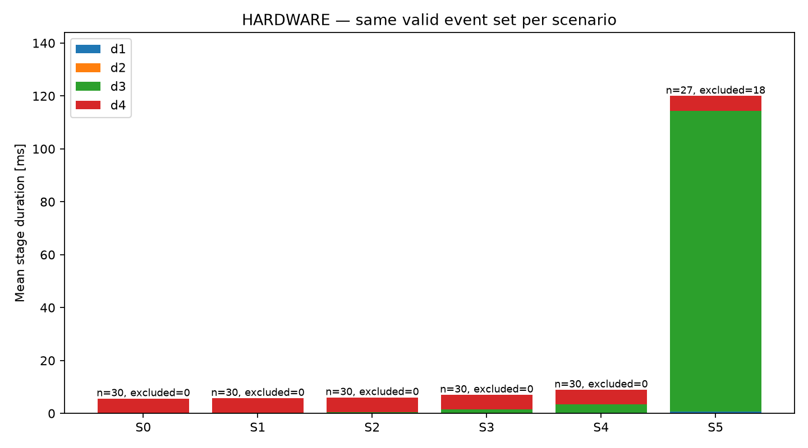
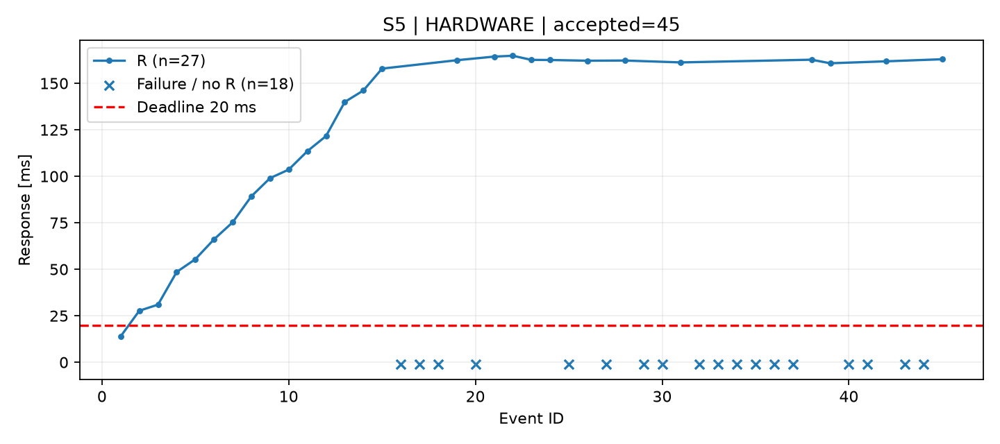

# Hafta 01 — Gerçek kart ölçüm raporu

24 Eylül 2026 tarihinde STM32F407G-DISC1 ve COM5 TTL bağlantısıyla S0–S5 deneyleri tamamlandı. Toplam 195 kabul edilen fiziksel olayın 177'si UART ile iletildi. S5'te 18 TX kuyruk düşmesi ve tamamlanan iletimler içinde 26 deadline ihlali ölçüldü.

## Yöntem

USART2 115200 8N1, LF dahil 64 bayt çerçeveler, 1 MHz TIM5, 1 kHz RTOS tick kullanıldı. Telemetry/Button/UART öncelikleri 3/2/1, Button/TX kuyruk uzunlukları 8/16 idi. Her senaryoda 5 saniye ısınma ardından en az 30 olay, kabul edilen kenarlar arasında en az 0,5 saniye aralık sağlandı. R=t4−t0 MCU üzerinde ölçüldü; PC varış zamanı kullanılmadı.

Seçim kuralı her senaryonun örnek sayısı, basış aralığı ve dump bütünlüğü koşullarını sağlayan en yeni COMPLETE kaydıdır. Seçim gecikme veya kayıp oranına göre yapılmadı. Önceki denemeler arşivde tutuldu; gerekçeler [selection.json](../measurements/selection.json) içindedir. Sentetik veri dahil değildir.

Altı koşu aynı Release/-Os ELF ile gerçekleştirildi. SHA256: `1d808b630065538a1d4824aaf96ed170b7ad6a43cc7d453f0e1b6555c36486f1`. Kaynak değişiklikleri henüz commit edilmediğinden build metadata'sında `git_dirty=true` vardır; kaynak commit'i tek başına ölçülen firmware'i temsil etmez. Seçilen deneylerde işlemci debugger ile durdurulmadı.

## Sonuçlar

R istatistikleri yalnız iletimi tamamlanan olaylara aittir. Düşen olaylar sıfır gecikme olarak değerlendirilmez. Tamamlanan iletimlerin bir bölümü geç olabilir.

| Senaryo / run | Kabul | Tamamlanan | TX düşme | Geç tamamlanan | R min / ort / maks (ms) | TX kuyruk tepe |
|---|---:|---:|---:|---:|---:|---:|
| S0 / 14 | 30 | 30 | 0 | 0 | 5,599 / 5,603 / 5,607 | 1 |
| S1 / 15 | 30 | 30 | 0 | 0 | 5,599 / 5,732 / 9,460 | 1 |
| S2 / 9 | 30 | 30 | 0 | 0 | 5,599 / 6,026 / 9,526 | 1 |
| S3 / 10 | 30 | 30 | 0 | 0 | 5,600 / 7,001 / 10,628 | 1 |
| S4 / 11 | 30 | 30 | 0 | 0 | 5,601 / 8,912 / 13,091 | 2 |
| S5 / 13 | 45 | 27 | 18 | 26 | 13,931 / 119,970 / 164,794 | 16 |

Tam hassasiyetli sonuçlar [summary.csv](../measurements/summary.csv) dosyasındadır. Ham kayıtlar `measurements/selected/S0` … `S5` altında events.csv, metadata.json ve serial_raw.bin olarak korunur.

S1–S5 gerçek üretim hızları sırasıyla 10,00015; 50,00041; 100,00081; 100,00194; 100,00035 Hz oldu. S4 iş kalibrasyonu ortalaması 1999 µs, S5 ortalaması 5000 µs (min 5000, maks 5001 µs) ölçüldü.

## Yorum

S0→S3 frekans artışıyla ortalama R 5,603 ms'den 7,001 ms'ye çıktı. TX başlangıcını bekleme aşaması d3 ortalaması 18,7 µs'den 1417,6 µs'ye yükseldi. S4'te ek CPU işiyle ortalama d1 265,5 µs, d3 3070,3 µs oldu; örneklemde bütün olaylar 20 ms deadline içinde tamamlandı.

S5'te d3 ortalaması 113,644 ms'ye çıktı; TX kuyruğu 16/16 doluluğa ulaştı. Buton iletilerinin 18'i ve telemetri iletilerinin 12'si kuyruğa alınamadı. Tamamlanan 27 buton iletiminin 26'sı geç bitti. d4 ortalaması yaklaşık 5,553 ms kaldı. Bulgular yüksek öncelikli CPU işi ve UART görevinin zamanlanması altında kuyruk beklemesinin baskın hale geldiğini destekler; kesin zamanlama izi değildir. Bu yük sonucunu gizlemek için öncelik, kuyruk veya baud değiştirilmedi.

Seçilen koşularda UART TX hatası, TX/drain timeout, button queue drop, record overflow veya kayıtsız olay yoktur. Dump'lar CRC ve kayıt sayılarıyla doğrulandı. S5'te düşen olaylar kayıtlarda açıkça korunmuştur.

Her senaryonun ayrı grafiği `analysis/plots/S0_response.png` … `S5_response.png` altındadır.

## Yeniden üretim ve sınırlar

Repo kökünde `./interface/.venv/Scripts/python.exe -m analysis.select_runs` seçimi ve grafikleri yeniden üretir. Seçili dosyalar farklı içerikle mevcutsa araç üzerine yazmak yerine durur. Ham arşiv `measurements/runs/`, teslim kopyaları `measurements/S0.csv` … `S5.csv` ve `Sx_meta.json` dosyalarıdır.

Gözlenen maksimum kanıtlanmış WCRT değildir. Manuel basış fazı ve sınırlı örnek sayısı sonuçları etkiler. d4 hat süresiyle HAL/IRQ ek yükünü içerir; gerçek baud bölücüsü nominal bauddan küçük sapma yaratabilir. Fiziksel kenar/son bit için bağımsız logic analyzer doğrulaması yapılmadı. Diğer doğrulama sınırları [uygulama durumundadır](../docs/review/implementation-status.md).
