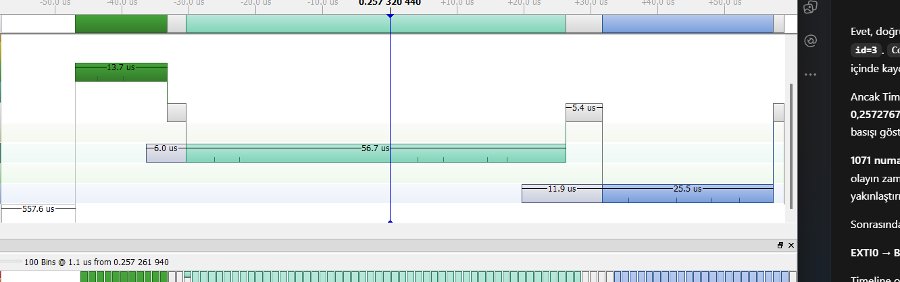
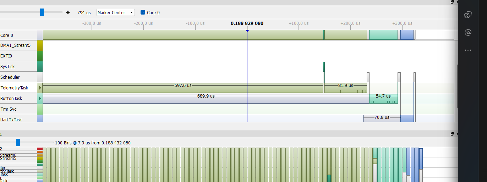

# V2 — S0 ve S5 SystemView gözlem raporu

3 Ekim 2026. Kullanıcıyla yapılan fiziksel gözlemlerin raporudur. Kullanıcının son kararıyla S1–S4 kapsam dışıdır.

## Kaynak ve yöntem

V2-QWB kaynak commit: `32f7e1dfeb69075d02084f08b4596d8febdccfb4`. İzleme yaması ayrı uygulanmıştır; özgün commit bu ekleri içermez. FreeRTOS 10.3.1, STM32F407VG, Release/-Os, 168 MHz CPU ve 1 MHz TIM5 kullanıldı. BTN önceliği 2, TEL 3, UART 1; USART2 460800 baud; ayrı BTN/TEL kuyrukları ve BTN önce seçimi korunmuştur.

Kart üzerindeki ST-LINK ile CPU durdurulmadan, otomatik durdurulmuş 64 KiB RAM trace tamponu okundu. USB–TTL üzerinden alınan CRC doğrulamalı UART dump, tüm koşunun t0–t4 ölçümlerini taşır. S0: 6 × 1000 ms; S5: 8 × 500 ms SystemView penceresi. Bu süre farkı kaydedilmiştir; V1 için de aynı senaryoya aynı pencere ayarı uygulanmalıdır.

**İstatistikler tüm koşudaki tamamlanmış basışlardan hesaplanmıştır.** Trace pencerelerinin dışında da basış vardır; her UART olayı SystemView içinde bulunmaz. Bu nedenle sonuçlar kesintisiz trace açık ölçümü veya izleme kapalı referans ölçümü değildir. İzleme ek yükü için ayrı eşlenmiş deney yapılmadı; etkisi nicel olarak ayrıştırılamaz. SWD okuma pencereler dışındadır, fakat tüm koşu istatistiğine etkisi sıfır varsayılmaz.

TIM5 farkları unsigned 32 bit olarak hesaplandı. p95 yöntemi: sıralı dizide `ceil(0.95*n)` konumu (nearest rank). Düşen olaylar sıfır gecikme olarak istatistiğe katılmaz.

## Koşu sonuçları

| Senaryo | Kabul/tamamlanan | Min (ms) | Ortalama (ms) | Medyan (ms) | p95 (ms) | Maks (ms) | >10 ms | >20 ms |
|---|---:|---:|---:|---:|---:|---:|---:|---:|
| S0 | 62/62 | 1.471 | 1.477 | 1.473 | 1.494 | 1.498 | 0 | 0 |
| S5 | 78/78 | 1.471 | 1.864 | 1.619 | 2.761 | 3.256 | 0 | 0 |

Her iki koşuda button/BTN TX/TEL kuyruk kaybı, UART hatası, TX timeout, kayıt taşması ve decoder hatası 0. S0’da 10, S5’te 4 debounce reddi var; bunlar kabul edilmiş olayların kaybı değildir. Tüm 14 trace penceresi kayıpsızdır.

| Sayaç | S0 | S5 |
|---|---:|---:|
| tel_generated | 0 | 3986 |
| tel_completed | 0 | 3986 |
| buttonq_hwm | 1 | 1 |
| btn_txq_hwm | 1 | 1 |
| tel_txq_hwm | 0 | 1 |
| period_overrun | 0 | 0 |

## Birlikte incelenen olaylar

S0 `window-01`: run=2, id=3, SystemView sıra 1071–1104. S5 `window-01`: run=3, id=2, sıra 1953–1996. Olay kimlikleri farklı basışları gösterir; eşlenmiş fiziksel giriş değildir.

| TIM5 aşaması | S0 örneği (µs) | S5 örneği (µs) |
|---|---:|---:|
| t1−t0 | 24 | 708 |
| t2−t1 | 27 | 27 |
| t3−t2 | 48 | 45 |
| t4−t3 | 1394 | 1395 |
| Toplam t4−t0 | 1493 | 2175 |

S5’te buton kesmesi geldiğinde TelemetryTask son iş dilimindedir (`WORK_BEGIN`, sıra 1949, slice=4). ButtonTask sıra 1955’te Ready olur. Kesme dönüşünde daha yüksek öncelikli TelemetryTask devam eder. `WORK_END` 1959; telemetri enqueue 1961; TelemetryTask `vTaskDelayUntil` ile 1965’te bloklanır. ButtonTask 1966’da çalışır. Bu örnek dilimler arasındaki `vTaskDelay(1)` yerine **son dilim sonundaki periyot beklemesini** gösterir. Önceki dilimin `vTaskDelay(1)` ve bloklanması 1940–1941’de görülür.

ButtonTask’ın Ready→Run beklemesi SystemView’da 689,911 µs; TIM5 t1−t0 değeri 708 µs’dir. Sınırlar farklıdır: t0 kesme içinde alınır; t1 task switch-in değil kuyruktan alımdır. Birbirine eşit olmaları beklenmez.

Telemetri mesajı sıra 1961’de, BTN mesajı 1971’de kuyruğa girmiştir. UART görevi 1976’da `btn_tx_q` kuyruğundan alır ve 1978’de BTN gönderimini başlatır. Bu kayıt BTN önce seçimini doğrudan gösterir; başlamış bir UART aktarımının kesildiği anlamına gelmez.

UART görevi DMA başlatıldıktan sonra 1979’da bloklanır ve Idle çalışır. 1395 µs’lik t4−t3 süresi CPU’nun tamamını tüketen çalışma süresi değildir. DMA tamamlanması ile UART TC ayrı sınırlar olarak kaydedilmiştir.

## Yorum ve sınırlar

S0 düşük yük referansını, S5 ise 100 Hz telemetri ve yaklaşık 5 ms CPU işini gösterir. İncelenen S5 basışında S0 örneğine göre artış çoğunlukla t1−t0 aşamasındadır. İş dilimleri yüksek öncelikli görevin CPU’yu tek parça tutma süresini sınırlar; ButtonTask hazır olduğunda yüksek öncelikli görevi doğrudan kesmez.

Bu koşularda 10 ms aşımı gözlenmedi. Bu, V2’nin tüm giriş fazları veya tüm çalışma koşulları için deadline garantisi değildir. Hafta 1’in kapsamlı kabul testinin yerine geçmez. S5’te uygulamanın raporladığı maksimum iş dilimi 1091 µs, maksimum aktivasyon duvar süresi 9116 µs; 5 ms CPU işinin duvar süresiyle aynı olmadığı görülür.

V1 S0/S5 ölçümleri 4 Ekim 2026 tarihinde tamamlandı. Karşılıklı senaryo sonuçları ve nedenleri [ana karşılaştırma raporunda](V1_V2_Karsilastirma.md) yer alır. Bu V2 raporu kendi koşularını anlatır; bağımsız değişiklik katkısı iddia etmez.

## Kanıt dosyaları

- [Kaynak farkı](../provenance/v2-instrumentation.patch), [kaynak koruma denetimi](../provenance/source-audit.json).
- [Build kimliği](../provenance/builds/v2/build.json).
- [S0 çözümlenmiş SystemView olayları](../docs/s0-observation-events.csv).
- [S5 çözümlenmiş SystemView olayları](../docs/s5-observation-events.csv).
- [S0 ham dump](../traces/v2/S0/20261003-160814-observation/dump.json), [oturum metadata](../traces/v2/S0/20261003-160814-observation/session.json), [incelenen SystemView kaydı](../traces/v2/S0/20261003-160814-observation/window-01/recording.SVDat).
- [S5 ham dump](../traces/v2/S5/20261003-161935-observation/dump.json), [oturum metadata](../traces/v2/S5/20261003-161935-observation/session.json), [incelenen SystemView kaydı](../traces/v2/S5/20261003-161935-observation/window-01/recording.SVDat).

## Kullanıcıyla incelenen ekranlar

S0: EXTI ardından ButtonTask ve UART görevi. Kullanıcının gözlem sırasında paylaştığı özgün ekran kesiti.

S5: ButtonTask satırındaki 689,9 µs gri çubuk Ready bekleyişidir; 54,7 µs su mavisi çubuk Running süresidir. Bu süreler t1−t0 ve t2−t1 ile aynı sınırları ifade etmez. Ekranlar değiştirilmeden saklandı.

Hazırlık pilotları ayrı korunur; butonsuz veya taşmış eski pilotlar bu sonuç tablosuna alınmadı. `session.json` içindeki “pilot” etiketi aracın veri toplama sınıflamasıdır; bu rapor yalnız yukarıdaki kullanıcıyla incelenen iki koşuyu kullanır. Gözlem onayı, biçimsel zamanlama kabulü değildir. Entegrasyon ve rapor hesaplamaları Codex yardımıyla hazırlanmıştır.
